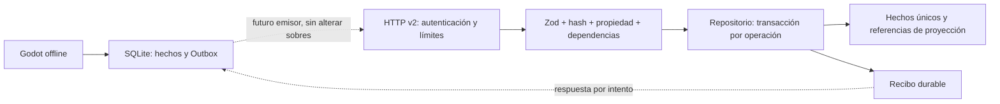

> **Estado vigente F.1B ? 2026-10-29 Guatemala:** coordinaci?n persistente implementada en c?digo aislado: MongoIdentityRepository, guard durable por propietario y UoW com?n de ingesti?n/revocaci?n. 462 pruebas backend offline aprobadas (41 nuevas, 421 regresiones). La composici?n Mongo con identidad memoria/archivo ahora falla cerrada. Sin Atlas, migraci?n o cambios de datos protegidos. Garant?a Mongo real a?n pendiente; **F.2 sigue deshabilitada, B00 pendiente y B05.5 no iniciada**. [Implementaci?n, pruebas y requisitos siguientes](B05_DURABLE_REVOCATION_IMPLEMENTATION.md). Los estados anteriores se conservan como antecedentes.

> **Estado vigente B05.4C.2C:** modo Atlas explícito implementado y probado exclusivamente con dobles, 271 pruebas backend aprobadas. Sin conexión Atlas real; identidad durable/B00 pendientes. El [informe del modo](B05_ATLAS_INTEGRATION_MODE.md) actualiza las propuestas e implementaciones históricas siguientes; D no iniciada.
> **Estado vigente B05.4C.1:** adaptador MongoDB/Mongoose implementado y probado con dobles; 235 pruebas backend aprobadas. Integración MongoDB real pendiente por falta de entorno local desechable. Las secciones B05.4A/B conservan sus resultados históricos. Véase [informe C.1](B05_MONGODB_ADAPTER_IMPLEMENTATION.md).
# Receptor Outbox — B05.4B implementado en ensayo sintético

**Estado vigente, 2026-10-28 Guatemala:** B05.4B COMPLETADA EN CÓDIGO en el ámbito sintético autorizado; ver sección B05.4B al final. POST /api/v2/sync/batches y consulta de recibos se componen explícitamente con JWTv2/repositorio sintético coordinado. Defaultapp/server no los activa. Sin Atlas, cliente HTTP Godot ni cambios de datos reales. El diseño A siguiente conserva sus estados históricos, no describe una nueva implementación de producción.

## Contrato aprobado en B05.4A (antecedente)

2026-10-28, America/Guatemala. **COMPLETADA COMO DISEÑO exclusivamente.** Nada de este documento añade endpoints, repositorios productivos o transporte al videojuego. B05.4B requiere autorización. B00 permanece pendiente. Los nombres de funciones nuevos y los esquemas siguientes son especificación propuesta, no código instalado.

## 1. Inspección y situación real

Se contrastaron los14 documentos obligatorios con código y pruebas; el código prevalece sobre propuestas antiguas. Los906pending,889/889hechos y791regresiones de E.2 son evidencia anterior, no una nueva auditoría SQL o ejecución en esta fase. No se extraen operaciones de runtime para diseñar fixtures.

| Rutas inspeccionadas | Hallazgo actual |
|---|---|
| `backend/package.json`, `package-lock.json` | Express5.3.0, jose6.2.13, Zod4.6.7; Argon2id2.2.2 y Vitest5.0.5. Zod ya está instalado: la afirmación B05.1 de que solo era candidato es histórica. No instalar dependencias. |
| `backend/src/app.js`, `server.js`, `config/server.js` | Legacy opaco; JWT v1 opcional en memoria; rutas técnicas v2 opcionales mediante persistentJwt. No rutas sync ni Mongo implementados. Arranque por defecto no activa JWT v2 ni claves; producción sigue bloqueada. |
| `modules/auth/{jwt-service,jwt-schemas,auth-service,identity-repository,memory-repository,credential-hasher}.js` | Argon2id y RS256 reutilizables; puerto async de identidad. v2 verifica vínculo/épocas contra cuenta y sesión. No repositorio de ingestión existente. |
| `config/jwt.js`, `middleware/{authentication,authorization,security,rate-limiter}.js`, `utils/errors.js` | Firma RS256 explícita, issuer/audience de pruebas, expiración900s, cuenta/sesión activa, roles y propietario. Parser actual8KiB para autenticación; no sirve sin configuración separada para lotes256KiB ni detecta por sí solo claves JSON duplicadas. |
| `tests/jwt/jwt.test.js`, `tests/identity-persistence/{persistence.test.js,support/*}`, `tests/{unit,integration}/*`, `vitest.config.js` | Tests reales de firma/claims/roles/binding, revocación, reinicios y archivos sintéticos cifrados; guardas .env y envDir=false. Archivo sintético no demuestra índices/transacciones Mongo. No se ejecutan en A. |
| `local-persistence/src/{SyncOutboxModels,SyncOutboxProjection,SyncOutboxService,SyncOutboxSchema,SyncFactInventory,SyntheticOutboxReconciler,Validation,GameplayEventSchema,GameplayEventService,LocalFinalEvaluator}.cs.txt` | Cuatro tipos y sobre inmutable de nueve campos. OperationId/hash/lease/intento/dependencias se guardan fuera del sobre. Canonical ordena claves ordinalmente y conserva tokens escalares mediante GetRawText. |
| `integration/sqlite/{RealGameCatalog,GamePersistenceAdapter,GamePersistenceContext}.cs`, fuentes de captura y pruebas Outbox | Catálogo inicial conocido, SQLite autoritativo, captura local y cierre independiente de HTTP. No emisor remoto/binding técnico compuesto con Godot. Sin cambios. |

Documentos revisados: OUTBOX_RUNTIME_RECOVERY_RESULT, OUTBOX_RUNTIME_POSTVALIDATION, OUTBOX_CAPTURE_RECONCILIATION, LOCAL_OUTBOX_IMPLEMENTATION, SYNC_ARCHITECTURE, SYNC_API_CONTRACT, GLOBAL_STATISTICS_PLAN, PERSISTENT_IDENTITY_CONTRACT, JWT_KEY_LIFECYCLE, IDENTITY_IMPLEMENTATION_PLAN, IMPLEMENTATION_ROADMAP, PHASES, PHASE_HISTORY y DECISIONS, todos bajo backend/docs.

## 2. Arquitectura y límites



El diagrama es diseño futuro. En A no se ejecuta ninguna flecha remota. SQLite decide el progreso; remoto es réplica analítica mínima, sin snapshot de continuación, posición, recursos, checkpoints, nombre visible o secretos. Un fallo remoto deja sync pendiente; no bloquea jugar, FinNivel, decisiones o finales.

Se elige un repositorio abstracto con un adaptador sintético para B y otro Mongo futuro. No importar archivos/identidades de pruebas como jugadores ni usar MemoryRepository como persistencia productiva. No habilitar NODE_ENV=production, cargar .env, generar claves alternativas o conectar Atlas por inferencia.

## 3. Versiones y formato de transporte

Ruta elegida: **POST `/api/v2/sync/batches`**, autenticada exclusivamente con JWT técnico **ver:2**. Propuesta complementaria de recuperación de ACK: POST `/api/v2/sync/receipts/query`. No se implementa ninguna en A. Las propuestas sync `/api/v1` de B05.1 se sustituyen explícitamente en el diseño; jamás existieron handlers sync publicados. Rutas legacy/v1/v2 técnicas actuales mantienen su comportamiento.

Hay tres versiones distintas: transporte HTTPschemaVersion2; sobre OutboxschemaVersion1; tokenver2. No se renombra una versión para igualarlas. El recibo durable declara operationContractVersion1 dentro de la respuesta HTTPv2.

Solicitud:

```text
{
  schemaVersion: 2,
  batchId: UUIDv4,
  operations: [{
    operationId: UUIDv4,
    payloadHash: SHA256 hexadecimal minúsculo de canonicalEnvelope,
    canonicalEnvelope: string con el JSON EXACTO almacenado en SQLite,
    dependencies: [UUIDv4 de operaciones padre],
    leaseId: UUIDv4 del intento local actual,
    attempt: entero seguro >= 1
  }]
}
```

canonicalEnvelope contiene exactamente nueve campos, todos obligatorios, incluso los null:

```text
{schemaVersion:1,type,installationId,localPlayerId,bindingGeneration,
 gameId:UUID|null,sourceKey,createdAtUtc,payload}
```

No contiene operationId, payloadHash, sourceId, origin, dependencias, lease, attempt, token o technicalAccountId. sourceId se deriva del payload; origin solo aparece en coverage de game/session. No inventar coverage/origin para eventos o intervalos. El identificador operationId dentro de una decisión identifica el comando de dominio, NO la operación Outbox exterior.

dependencies se obtiene de sync_dependencies, no de UUID arbitrarios ni solo de gameplay.kind. Es metadata de transporte estable por operación y se verifica semánticamente en servidor; no se añade al hash ya almacenado. El futuro emisor necesitará leer esas referencias: Reserve hoy devuelve filas, no un body HTTP completo. Registrar ese trabajo como integración futura, sin modificar al productor en A/B.

Límites:1..100operaciones; body real UTF-8 máximo256KiB, sin compresión; canonicalEnvelope UTF-8 máximo16128bytes (límite local16KiB menos reserva256), máximo16dependencias sin repetidos/autorreferencia; profundidad del JSON interior máxima8 como JsonObject local. Tamaño exterior de transporte se mide sobre bytes realmente codificados: escapar canonicalEnvelope como string aumenta el tamaño y la estimación local Reserve(envelope+256) NO es garantía de tamaño HTTP. El futuro emisor divide por bytes reales conservando IDs/sobres. No elevar el parser8KiB de auth: usar parser específico256KiB para sync. Cuota inicial propuesta120lotes/min por identidad y60/min por IP para no autenticados; límites compartidos/productivos y rendimiento quedan como puerta de despliegue, no configuración aplicada.

Rechazar query, charset distinto de UTF-8, Content-Encoding distinto de identity y headers Authorization múltiples. No loguear Authorization, body, canonicalEnvelope, credencial, PHC o claves. RequestId/batchId son correlación, nunca clave de efecto idempotente.

Cadena futura elegida: rejectQuery/cotas de headers y rate IP→authenticate(JwtServicever2)→authorize(player)→resolver contexto→parser sync acotado/sin duplicados→validación del lote y servicio→serializador de resultados. **No reutilizar el array protectedV2 de los GET:** incluye requireEmptyRequest y rechazaría un POST válido. Tampoco reutilizar parseJson8KiB de auth ni modificar sus cotas globales. Un manejador de errores específico del router sync emitirá el formato2 seguro (error/code/message fijo/retryable/requestId); el errorHandler global actual devuelve schemaVersion1 y debe conservar compatibilidad legacy. No cambiarlo globalmente para simular que ya soporta syncv2.

## 4. Identidad y propiedad

Reutilizar JwtService v2, no otro verificador ni fallback v1/opaco. Valida firma RS256, alg/typ/kid, issuer y audience exactos, exp/iat/nbf yTTL900s, sub/jti, rol, cv, ver2, installationId/localPlayerId/bindingGeneration/authzVersion. Cuenta activa, sesión no vencida/revocada y épocas deben seguir coincidiendo con repositorio. Fallo de identidad/revocación503 falla cerrado, no aceptación desde caché ni401 ficticio. role player es obligatorio; admin no es una excepción para subir por el juego. No alta administrativa pública, ni rol del JSON.

**Brecha real:** authenticate retorna solo `{id,role,sessionId}` aunque verifica claims de vínculo internamente. El futuro controlador no debe inventar request.principal.binding ni decodificar un JWT sin verificar para recuperarlo. **Se elige un middleware de resolución de contexto** mediante repositorio de identidad a partir de id/sessionId ya autenticados, revalidando cuenta/sesión y sus épocas. No se cambia silenciosamente el principal de las rutas existentes. El receptor recibe `{technicalAccountId,installationId,localPlayerId,bindingGeneration,cv,authzVersion,sessionId,expiresAt}` de esa fuente confiable.

El wrapper específico de sync conservará el mismo string JWT que authenticate ya verificó; solo después puede leer sus claims para fijar `expiresAt=min(exp*1000,session.expiresAt)` y conservar las épocas/vínculo esperados. Volver a comparar sub/jti/role/cv/ver/installationId/localPlayerId/bindingGeneration/authzVersion de ese mismo token verificado contra cuenta/sesión actuales; no adoptar un vínculo nuevo solo porque cambió el repositorio entre ambas lecturas. El contexto autorizado se construye desde repositorio con esas restricciones, no desde un JSON declarado por cliente. Nunca usar decode sin verificación previa ni usar un claim como única autoridad. Comprobar solo expiry del registro de sesión podría diferir del límite exacto del token. Si no se conserva esa evidencia verificada, falla la composición: no inventar expiración desde createdAt o TTL supuesto.

Cada sobre debe igualar el vínculo autorizado; no basta un UUID correcto. Antes de escribir o revelar hechos, resolver referencias exclusivamente dentro del scope (technicalAccountId,installationId,localPlayerId,bindingGeneration). Un scope declarado ajeno produce403 genérico. Un UUID de dependencia no encontrado en el propio scope produce el mismo deferred tanto si no existe como si pertenece a otra cuenta: no buscarlo globalmente para distinguirlo y filtrar esa existencia. Un gameId igual al de otra cuenta nunca se atribuye a ella; los registros nuevos viven en el namespace autenticado. No adoptar el vínculo local sync_installations como identidad remota ya registrada: ese enlace cliente aún no está compuesto.

Para revocación concurrente, el puerto de ingestión incluye un **fence de autorización** coordinado con identidad. En fake, ambos usan la misma mutación exclusiva. En Mongo futuro, transacción de ingestión y revocación escriben condicionalmente el mismo documento de control/época; una simple lectura snapshot no basta para impedir carrera. Reintentar write conflict y volver a comprobar active/cv/authzVersion/binding/sesión. No certificar esta garantía con Maps o archivos como si fuese Mongo. Expiración se comprueba al admitir lote y en cada operación antes de commit; si expira a mitad, lo ya confirmado conserva su recibo y el resto devuelve error por elemento401/retryable tras reautenticación, sin otra identidad.

## 5. Esquemas Zod propuestos: forma exacta

Especificación documental con la API Zod4 ya presente, no ejecución. Helpers semánticos se definen en la sección6. Todos los objetos son strict; ningún coerce/default convierte ausencia en0. Los campos nullable siguen siendo obligatorios. Versiones string son claves ASCII de1..64caracteres; validación de catálogo se hace después de forma.

```javascript
const uuid = z.string().regex(/^[0-9a-f]{8}-[0-9a-f]{4}-4[0-9a-f]{3}-[89ab][0-9a-f]{3}-[0-9a-f]{12}$/);
const n = z.number().int().min(0).max(Number.MAX_SAFE_INTEGER);
const positive = n.min(1);
const key = z.string().regex(/^[A-Za-z0-9._-]{1,64}$/);
const utc = z.string().regex(/^\d{4}-\d{2}-\d{2}T\d{2}:\d{2}:\d{2}\.\d{3}Z$/)
  .refine(s => !s.startsWith('0000-') && Number.isFinite(Date.parse(s)) && new Date(s).toISOString() === s);
const biome = z.enum(['ocean','jungle','desert','forest','tundra']);
const origin = z.enum(['live_capture','historical_import']);
const coverage = z.strictObject({origin, historicalCoverageUnknown:z.literal(true), incomplete:z.boolean()});
const classification = z.strictObject({kind:z.enum(['favorable','perjudicial']),version:key});
const decision = z.strictObject({
  decisionId:uuid, operationId:uuid, biomeId:biome, decisionKey:key,
  optionId:z.enum(['reject','approve']), decisionOrder:positive,
  consequencesVersion:z.union([z.literal(1),z.literal(2)]),
  stateKind:z.enum(['healthy','degraded']), classification:classification.nullable(),
  rulesVersion:key, occurredAtUtc:utc
});
const progress = z.strictObject({
  biomeId:biome, status:z.enum(['human_pending','animal_pending','completed']),
  result:z.enum(['good','bad']).nullable(),
  humanCompletedAtUtc:utc.nullable(), animalCompletedAtUtc:utc.nullable()
});
const game = z.strictObject({
  gameId:uuid, revision:n, rulesVersion:key, contentVersion:key, saveFormatVersion:z.literal(1),
  status:z.enum(['in_progress','final_pending','completed','archived']), isCurrent:z.boolean(),
  createdAtUtc:utc, savedAtUtc:utc, ending:z.enum(['good','medium','bad']).nullable(),
  endingRulesVersion:key.nullable(), preparedAtUtc:utc.nullable(), closedAtUtc:utc.nullable(),
  biomes:z.array(progress).length(5), decisions:z.array(decision).max(5), coverage
});
const session = z.strictObject({
  sessionId:uuid, phase:z.enum(['open','terminal']), status:z.enum(['open','closed','interrupted']),
  startedAtUtc:utc, endedAtUtc:utc.nullable(), endOffsetMs:n.nullable(), coverage
});
const event = z.strictObject({
  eventId:uuid,sessionId:uuid,
  kind:z.enum(['ANIMAL_SEGMENT_STARTED','ANIMAL_DIED','ANIMAL_RESTART_REQUESTED',
    'ANIMAL_RETRY_REQUESTED','ANIMAL_SEGMENT_EXITED','ANIMAL_SEGMENT_COMPLETED']),
  occurredAtUtc:utc,offsetMs:n,gameId:uuid,biomeId:biome,animalRunId:uuid,
  deathCause:z.enum(['Unknown','Damage','Fall']).nullable(),sessionEnd:z.null(),version:z.literal(1)
});
const interval = z.strictObject({
  intervalId:uuid,sessionId:uuid,gameId:uuid.nullable(),biomeId:biome.nullable(),
  animalRunId:uuid.nullable(),startMs:n,endMs:n,
  state:z.enum(['ActiveHuman','ActiveAnimal','Paused','Menu','GameOver','Loading','Background']),
  version:z.literal(1)
});
const base = {schemaVersion:z.literal(1),installationId:uuid,localPlayerId:uuid,
  bindingGeneration:positive,gameId:uuid.nullable(),sourceKey:z.string().min(1).max(192),createdAtUtc:utc};
const envelope = z.discriminatedUnion('type',[
  z.strictObject({...base,type:z.literal('game.report'),payload:game}),
  z.strictObject({...base,type:z.literal('session.report'),payload:session}),
  z.strictObject({...base,type:z.literal('gameplay.event'),payload:event}),
  z.strictObject({...base,type:z.literal('gameplay.interval'),payload:interval})
]);
const operation = z.strictObject({
  operationId:uuid,payloadHash:z.string().regex(/^[0-9a-f]{64}$/),
  canonicalEnvelope:z.string().min(2).max(16384),
  dependencies:z.array(uuid).max(16),leaseId:uuid,attempt:positive
});
// El tamaño en bytes y el parser sin duplicados son obligatorios fuera de Zod.
const batch = z.strictObject({schemaVersion:z.literal(2),batchId:uuid,
  operations:z.array(z.unknown()).min(1).max(100)});
```

El array exterior unknown es intencional: validar cada elemento con operation/envelope permite rechazo individual de uno inválido sin perder otros válidos. Un elemento sin operationId válido se identifica por índice y operationId:null; no puede producir recibo ni confirmar una fila local. Claves duplicadas en JSON exterior, estructura exterior inválida o batch vacío se rechazan globalmente antes de procesar. canonicalEnvelope se parsea con detector de claves duplicadas y profundidad8 antes de usar Zod; JSON.parse por sí solo perdería esa evidencia.

El preflight del lote rechaza operationId repetido dentro del mismo array con400, antes de commits, para evitar dos respuestas ambiguas para una fila. Repetir el lote completo en otra solicitud sí es válido. batchId no impide que otra solicitud transporte otro conjunto de operaciones. Self-dependency o ciclo visible entre elementos→invalid_dependencies por operación involucrada; no esperar indefinidamente. UTF-8 inválido/BOM no admitido; medir bytes reales aunque Content-Length sea incorrecto.

### Matriz de identidades y dependencias

| Tipo único | ID fuente / sourceKey recalculada | Dependencias semánticas mínimas |
|---|---|---|
| game.report |payload.gameId / `game:{gameId}:{revision}`|Vínculo técnico/perfil existente; decisiones/ambientes/progreso/final dentro del agregado, sin mensajes separados|
| session.report |payload.sessionId / `session:{sessionId}:open` o `:terminal`|open: vínculo; terminal: open de esa misma sesión|
| gameplay.event |payload.eventId / `event:{eventId}`|Sesión open, reporte de su partida; si no es start, evento ANIMAL_SEGMENT_STARTED de animalRunId|
| gameplay.interval |payload.intervalId / `interval:{intervalId}`|Sesión open; partida si gameId no null; start del run si animalRunId no null|

OperationId es otro UUID independiente y estable por fila Outbox; no se sustituye por el ID fuente. Todos usan contract/schemaVersion1 y el scope autenticado. gameId exterior igual al payload en game/event/interval, null para session. Perfil solo vínculo técnico, no profile.report. SourceKey no se acepta como texto libre: debe coincidir exactamente con la derivada.

## 6. Validación semántica obligatoria

**Hash y canonicalización:** SHA-256 UTF-8 del canonicalEnvelope exacto, sin operationId/hash/dependencias/lease/intento. No usar hash de JSON.stringify del body HTTP ni RFC8785 por suposición. SaveValidation.Canonical ordena propiedades StringComparer.Ordinal y conserva representación escalar; .NET8 aplica su encoder al serializar. Verificar representación canónica y bytes sin normalizar escapes, números, mayúsculas o fechas para «arreglar» el cliente. Para el perfil1 cerrado actual, todos los campos textuales permitidos son ASCII; exigir enteros decimales sin -0/fracción/exponente y claves ordenadas. El parser/canonicalizador futuro debe demostrar equivalencia con el productor usando vectores C#/Node antes de activar recepción. No rehash de las906filas reales ni cambio de payload local para superar una discrepancia. Discrepancia bloquea integración, se conserva la cola y se diagnostica.

**game.report:** catálogo inicial rulesVersion `initial-state-only-1`, contentVersion `copy-initial-content-1`, saveFormat1; versión desconocida→unsupported_rules_version/content, sin interpretar como catálogo actual. Cinco biomas exactos sin duplicar; decisiones0..5, IDs/órdenes/biomas únicos y orden1..N. Claves: ocean_waste_disposal, jungle_transport_route, desert_cat_abandonment, forest_industrial_pesticides, tundra_fossil_extraction, respectivamente. Cada decisión usa rulesVersion de partida; reject→healthy y approve→degraded. consequencesVersion1 exige classification:null; versión2 exige kind/version. No inferir opción ni final desde favorable/perjudicial; clasificación es dato versionado y se agrupa solo por versión compatible.

Sin decisión: human_pending, result:null, fechas de completitud null. Con decisión: animal_pending o completed; completed requiere resultado good para healthy/reject o bad para degraded/approve. humanCompletedAtUtc/animalCompletedAtUtc se conservan cuando están informados; null sigue siendo desconocido según la forma permitida por el productor, no0 ni permiso para inventar fecha. animal_pending no resultado/fecha animal. No añadir constraints de recursos/posición o exigir visitas humanas no exportadas. Fechas son evidencia de reloj cliente, no prueba física ni base para recalcular offsets.

final_pending/completed exige cinco completed y cinco decisiones; endingRulesVersion=`local-ending-reject-count-1`. Contar reject:5→good,3/4→medium,0/1/2→bad; nunca otra fórmula. preparedAtUtc refleja preparación, no presentación. completed exige isCurrent=false; preparedAtUtc/closedAtUtc nullable no se reconstruyen por inferencia. final_pending no es cierre y no se cuenta como completed. archived se conserva como histórico según campos realmente informados; un ending en ese archivo no demuestra por sí solo final/cierre válido ni se cuenta completed sin evidencia. Una revisión antigua válida no retrocede la última proyección. Toda revisión debe respetar decisiones inmutables ya conocidas; revisión mayor no permite cambiar una elección ni deshacer un bioma confirmado. No exigir revisiones contiguas ni revisión0: el productor no conserva todas las intermedias.

**session.report:** open→status=open, endedAtUtc:null, endOffsetMs:null; terminal closed→endedAtUtc válido y endOffsetMs medido; terminal interrupted→**endedAtUtc:null**, endOffsetMs de última frontera durable. No inventar hora final al descubrir una interrupción. startedAtUtc igual entre fases. coverage.historicalCoverageUnknown=true; incomplete=true para open/interrupted, false para closed; game coverage.incomplete siempre true en productor actual. No se aceptan recordedThroughOffsetMs ni otros campos que solo existían en borradores.

**gameplay.event:** solo los seis tipos animales de la lista. SESSION_STARTED/ENDED pertenecen a la fuente SQLite pero se representan por session.report; no exportarlos como eventos duplicados. Start exige eventId=animalRunId; otros referencian start propio con misma sesión/partida/bioma y offset>=start. ANIMAL_DIED lleva DeathCause conocido; otros deathCause:null; sessionEnd:null siempre. Reintento requiere muerte previa, restart es solicitud distinta, completion exige evidencia completed del bioma y no prueba por sí sola otro cierre global. No exigir que una partida histórica siga activa al recibir su telemetría tardía. Verificar unicidad por run+kind y transiciones con servicio local como referencia, en ambos órdenes de llegada.

**gameplay.interval:** endMs>=startMs en milisegundos, ambos enteros seguros; sin duración declarada o fecha inventada. gameId:null exige biomeId/run null; game informado debe existir; run requiere game/bioma/start compatibles. ActiveAnimal exige run; ActiveHuman exige game/bioma y run null. Otros estados no fuerzan duración efectiva. Menu0..3932 representa3932ms=3,932s, aporte efectivo0; Paused/GameOver/Loading/Background también excluidos. Intervalos positivos no se solapan en la sesión (rangos [start,end)); repetición de misma frontera/categoría con otro UUID no crea otro hecho contabilizable. Conservar ceros medidos válidos sin convertir ausencias en0. Terminal cerrado/interrumpido acota endOffset de intervalos/eventos tardíos; no exige que ya hayan llegado todos. No derivar duración desde UTC ni imponer TTL a hechos antiguos por antigüedad de createdAt.

El receptor puede probar estructura, relaciones, repetición, consistencia entre mensajes y la fórmula de finales. **No puede probar que un ejecutable modificable llegó físicamente a FinNivel, murió o midió honestamente el tiempo.** JWT acredita dueño autenticado, no veracidad del gameplay ni una persona humana única. Agregados remotos se derivan de hechos únicos validados; no aceptar contadores totales suministrados por cliente.

## 7. Idempotencia y repositorio

Puerto propuesto `IngestionRepository.acceptOperation(authContext, validatedOperation)` y `findReceipts(authContext, descriptors)`, con lectura del vínculo y mutación atómica de todos los efectos. No usar check-then-insert sin exclusión/índice. La unidad es una operación, NO el lote entero.

Modelo propuesto:

| Colección lógica futura | Datos mínimos e índices |
|---|---|
| sync_operations |Owner/scope, operationId, referencia al hecho, encabezado canónico sin duplicar payload, payloadHash, hash/lista de dependencias, receivedAt servidor, resultado original y receiptId/committedAt. UNIQUE(technicalAccountId,operationId); otro binding/hash/contenido bajo ese ID es conflicto o scope inválido.|
| sync_facts |Scope, sourceKey/type/sourceId, payload validado guardado una vez, factDigest y primera referencia de operación. UNIQUE(scope,sourceKey). FactDigest usa type/schemaVersion/gameId/sourceKey/payload; excluye operationId, capture createdAt y metadata de intentos.|
| game_heads / session_heads / run_heads |Referencias a hechos únicos, revisión máxima/fase/run y versión CAS. No segunda colección de decisiones, resultados o muertes que vuelva a contarlos. Decisiones/progreso/final viven en game.report, no en otros tipos.|
| identity/binding/sessions existentes o futuros |Identidad/verificador y vínculo separados de ingestión; fence de autorización escrito por revocación y commit. UNIQUE(binding vigente) según contrato de identidad, no registro por UUID aportado.|

Conservar timestamp de captura original separado de receivedAt/committedAt servidor. La reconstrucción canónica del encabezado+payload debe verificar payloadHash original; no guardar secretos de autenticación. No TTL sobre claves de dedupe/recibos durante v1: reintento días después sigue idempotente. Cualquier futura retención requiere tombstones equivalentes y contrato aprobado antes de borrar evidencia.

Algoritmo atómico:

1. Resolver y verificar scope, formato/cotas/hash/sourceKey; revalidar autorización/épocas mediante fence.
2. Si operationId propio ya existe, exigir mismo scope, hash, encabezado, payload y dependencias estables. Devolver recibo original sin tocar proyecciones. No aceptar solo igualdad de un hash declarado por cliente.
3. Si sourceKey ya existe con factDigest idéntico pero otro operationId, registrar alias/recibo para la nueva operación y reutilizar el mismo hecho/efectos. Puede cambiar capture createdAt en el encabezado, no el hecho. Payload diferente bajo misma clave→source_conflict, incluso con otro ID. Las dependencias deben ser equivalentes y válidas; lease/attempt no afectan identidad del hecho.
4. Resolver dependencies del mismo owner/binding; sus tipos/IDs deben cubrir padres semánticos. No basta que el cliente declare que ya están confirmadas. Eventos/intervalos no exportan revisión de partida: la referencia a la operación padre permite identificar el game.report concreto. No imponer orden topológico del array como requisito; procesar orden recibido, devolver deferred si falta padre y aceptar el retry posterior.
5. Validar conocimiento anterior y rangos. Escribir hecho único, referencia de operación, cambios de heads y recibo en una sola transacción. Revisiones game antiguas aceptadas pueden tener resultado superseded (persistidas, sin retroceso); no borrar hechos útiles.
6. Confirmar persistencia antes de construir ACK. Ante commit incierto, consultar por la misma clave: nunca responder committed por haber intentado guardar.

Concurrentes con mismo operationId/fact: una gana; las demás releen ganador, comparan y devuelven duplicate o conflict. También serializar por game/session head los cambios que puedan violar monotonicidad/solapamiento: un índice UNIQUE(start,end,state) NO impide rangos parcialmente solapados. En Mongo futuro usar CAS/write fence por sesión y revalidar al reintentar, no confiar en una lectura sin conflicto contra inserciones concurrentes.

Fake inicial: almacenamiento en memoria explícitamente synthetic, entradas separadas de caller mediante clone, exclusión atómica y hooks de fallo. Para ensayos de reinicio, repositorio sintético durable de ingestión separado del archivo de identidad, mismo patrón de custodia cifrada y rutas privadas **solo tras autorización de B**; no reutilizar sus fixtures como datos reales. Respuesta tras snapshot atómico confirmado; crash/lock residual falla cerrado con503 y recuperación explícita, sin borrar lock a ciegas. La prueba sintética no demuestra durabilidad frente a apagón ni transacciones distribuidas.

Para archivos separados, «mutación exclusiva» exige un coordinador de exclusión común para revocación y aceptación, con orden de locks definido: lock de coordinación→lectura de identidad vigente→commit de ingestión. Todas las rutas de revocación del ensayo deben participar. No afirmar atomicidad multiarchivo por usar dos renames independientes. Si no se puede proporcionar esa exclusión compartida, el ensayo de carrera/revocación es un bloqueo, no una garantía de archivo ya existente. La validación de expiración se toma en el punto autorizado anterior a la mutación atómica; no se promete precisión temporal del fsync frente al SO.

Guardar una sola representación canónica del payload en sync_facts y encabezado inmutable en sync_operations; reconstruir el sobre debe reproducir el hash. No depender de la representación numérica/orden de un BSON reserializado: mantener bytes canónicos verificados. Las referencias de heads son proyecciones, nunca otros hechos para sumar.

Mongo futuro: colecciones e índices anteriores, transacción operación+hecho+heads+receipt+fence sobre despliegue compatible; writeConcern majority y readConcern snapshot. UnknownTransactionCommitResult se resuelve mediante lectura idempotente, nunca ACK supuesto; transient write conflict reintenta con cota. Índices/replica set/privilegios/driver deben validarse en entorno Mongo desechable autorizado antes de Atlas. Ningún modelo Mongo productivo se añade en A/B por esta propuesta.

## 8. Orden y errores

Identidad y vínculo técnico preceden recepción. game.report contiene decisiones/consecuencias/progreso/final del agregado, sin exigir eventos completos para aceptar progreso. session.open precede terminal/run. Run start precede hechos que lo referencian. Intervalos pueden llegar después del terminal si caben en sus límites; estado final de partida no impide telemetría histórica compatible. Dependencias aún no recibidas→**deferred/retryable**, sin ACK ni staging contabilizado. Se conserva la intención en Outbox para repetir, no se descarta dato válido por orden. No inventar una cola remota de aceptación provisional con recibo committed.

Los padres mínimos de sync_dependencies no agotan todas las relaciones semánticas. Por ejemplo, ANIMAL_RETRY_REQUESTED depende de una muerte previa de su run, aunque el transporte local no liste ese eventId como padre explícito. Si esa muerte propia aún no llegó, diferir por dependency_missing (run/kind), sin clasificar el retry como permanentemente inválido solo por orden. Si la evidencia ya recibida contradice la transición, rechazar conflicto. Comprobar ambos órdenes en B.

| Clase por elemento | httpStatus lógico | Recibo positivo | Acción local futura |
|---|---:|---|---|
| committed |201|Sí, durable|Confirmar solo intento actual verificado|
| duplicate |200|Sí, recibo original|No duplicar efectos|
| superseded |200|Sí, histórico persistido|Confirmar sin retroceder proyección|
| conflict / source_conflict / dependency_conflict |409|No|Cuarentena permanent_failure, conservar para revisión|
| dependency_missing |409|No|deferred/retryable; respetar retryAfterSeconds|
| invalid_fact / invalid_operation / unsupported_contract / unsupported_rules_version |422|No|Rechazo permanente de ese contenido; conservar, no regenerar UUID ni transformar datos|
| storage_unavailable / transaction_retry_exhausted |503|No|Retry con mismos IDs/hash|
| quota_exceeded |429|No|Retry-After y backoff|
| authentication_expired durante lote |401|No|Reautenticar mismo vínculo y repetir pendientes|

Errores globales previos a procesamiento:400JSON/estructura/lote vacío;401JWT;403rol;413bytes/cantidad;415tipo/encoding;429cuota;503identidad/repositorio indisponible;500sanitizado. Un binding de sobre incorrecto es403 por elemento; si es el único impedimento de un lote sin recibos, HTTP403 con sus resultados. En rechazos globales previos no se produce commit de operaciones. Si el fallo sucede después de commits individuales, conservarlos y sus recibos; error/timeout global nunca prueba que nada se guardó.

Respuesta por lote preserva índice de entrada y contiene schemaVersion2,batchId,requestId,outcome,counters,results. **200 solo si todas** tienen committed/duplicate/superseded con recibo. **207** si hay recibos y fallos, outcome=partial; nunca accepted:true global. Si ninguna tiene recibo:503 si hay fallos temporales,409 si solo conflictos,422 si solo inválidas;401/403 si el impedimento es autorización. Con mezcla sin recibos prevalece503 sobre409/422, manteniendo código individual. 413 global no procesa el lote. El cliente no deduce confirmación del HTTP200/207 ni de counters.

Presupuesto propuesto: transacción por operación máximo2s y admisión de lote máximo10s, sin waits infinitos; tras vencer, elementos no iniciados deferred503. Si ya comenzó una transacción con resultado desconocido, no mentir sobre rollback: resolver mediante clave/recibo al reintentar. Límites son propuesta a medir en B, no garantía aplicada hoy. Errores no exponen payloads, stacks, nombres de colecciones internas, claves, otros jugadores o detalles criptográficos.

## 9. Recibos y ACK por intento

Resultado positivo:

```text
{index,operationId,status:"committed"|"duplicate"|"superseded",httpStatus,
 receipt:{receiptVersion:1,operationContractVersion:1,technicalAccountId,
   operationId,localPlayerId,installationId,bindingGeneration,payloadHash,
   receiptId,committedAtUtc,acceptedAs:"committed"|"duplicate"|"superseded"},
 attempt:{leaseId,attempt}}
```

receiptId UUID y committedAtUtc UTC-milisegundos los crea el servidor y persisten **en la misma transacción** que el hecho y sus efectos. Para una misma operación se conservan en todos los retries/reinicios. technicalAccountId sale de la identidad autenticada; no se acepta receiptId/committedAt propuesto por cliente. Resultado rechazado/diferido no lleva recibo positivo: `{index,operationId,status, httpStatus,error:{code,retryable,retryAfterSeconds?}}`. Un índice no se usa como prueba de propiedad ni aceptación.

acceptedAs persiste el resultado original; un retry puede devolver status=duplicate sin cambiar acceptedAs, receiptId o committedAtUtc. Un alias nuevo del mismo hecho obtiene su propio recibo ligado a su operación/hash y acceptedAs=duplicate, sin repetir efectos.

Fragmento Zod de salida para B (usa uuid/utc/positive anteriores):

```javascript
const positiveStatus = z.enum(['committed','duplicate','superseded']);
const receiptCore = z.strictObject({receiptVersion:z.literal(1),operationContractVersion:z.literal(1),
  technicalAccountId:uuid,operationId:uuid,localPlayerId:uuid,installationId:uuid,
  bindingGeneration:positive,payloadHash:z.string().regex(/^[0-9a-f]{64}$/),
  receiptId:uuid,committedAtUtc:utc,acceptedAs:positiveStatus});
const receiptAttempt = z.strictObject({leaseId:uuid,attempt:positive});
const positiveResult = z.strictObject({index:n.max(99),operationId:uuid,status:positiveStatus,
  httpStatus:z.union([z.literal(200),z.literal(201)]),receipt:receiptCore,attempt:receiptAttempt});
```

Refinar que operationId/hash/scope/versiones coincidan con solicitud y registro; committed usa201 y duplicate/superseded200 a nivel de elemento. Códigos de error cerrados según sección8, mensaje fijo sin datos, retryAfterSeconds opcional1..900. results tiene un elemento por índice recibido, sin repetidos; counters de cada estado suman received y receipt count corresponde solo a positivos. Query solo retorna core previamente persistido; nunca crea un acceptedAs a partir de la consulta.

El recibo durable no incluye leaseId/attempt: pertenecen al envío actual. El servidor devuelve esos dos como correlación del request después de verificar recibo/hash/scope. Es un eco de correlación, no prueba independiente de un lease. El futuro coordinador C# verifica HTTPS confiable, contrato/versiones, cuenta, owner/installation/generation, operationId, hash y estado de resultado; comprueba que leaseId/attempt corresponden a su fila **in_flight vigente**. Solo entonces adapta a SimulatedSyncReceipt/Confirm existentes. Un ACK viejo, lease vencido, perfil cambiado o generación diferente no confirma nada; reconsulta/reenvía bajo intento nuevo y recibe el mismo núcleo durable.

Receipts query propuesta: `{schemaVersion:2,attempts:[{operationId,payloadHash,leaseId,attempt}]}`,1..100, scope derivado de JWT. Responde por descriptor con recibo encontrado o not_found, sin revelar IDs ajenos. not_found no prueba que no haya commit en vuelo; repetir operación original. Query devuelve el intento actual de la consulta para que la misma barrera local pueda validarlo; no inventa recibo si solo hay staging/timeout. Contrato con las mismas cotas/strict/auth del receptor.

HTTP200 de una consulta solo significa que se realizó la búsqueda; cada found necesita su recibo y cada not_found continúa pendiente. No aplicar a esa búsqueda la interpretación de lote de ingestión all_accepted.

Compatibilidad explícita: Confirm hoy valida estructura/scope/hash/lease/vigencia y guarda receipt JSON sin el campo status. No verifica red, firma de recibo o technicalAccountId; el nombre SimulatedSyncReceipt es real. Esa comprobación de procedencia será del coordinador futuro y no se considera implementada. El sobre local no necesita cambiar, pero **no es seguro conectar un JSON recibido directamente a Confirm**. La TLS/autenticación del servidor y el registro durable son la evidencia del protocolo; no se promete impedir que un usuario modifique su propia SQLite o cliente.

## 10. Puertas, compatibilidad y verificaciones de A

No se encontró necesidad de cambiar los cuatro payloads aprobados. Sí hay brechas que bloquean una activación real: vectores canónicos aún no ejecutados, transporte/lectura de dependencias y recibos aún no implementados, resolución de binding no expuesta por principal, repositorio Mongo/índices/transacciones ausentes, custodia/rotación productiva y B00 sin resolver. Se documentan; no se modifica contrato ni código silenciosamente. El carrier string preserva los bytes existentes y explicita tamaño exterior y versiones.

Plan verificable en [B05_REMOTE_INGESTION_TEST_PLAN.md](B05_REMOTE_INGESTION_TEST_PLAN.md). Revisión de consistencia documental y de campos contra fuentes reales, sin ejecutar Node, servidor, pruebas, Godot o SQL en A.791pruebas locales/124backend son antecedentes, no nuevas ejecuciones.

Integridad: las bases protegidas se comparan mediante hash/tamaño/mtime/descriptores, sin consultar sus filas. **.env no se abre ni siquiera para hash** en esta fase por prohibición expresa: solo tamaño/mtime/atributos/owner/SDDL. Referencia histórica278bytes/SHA-256 `4DB843D236E5FBB289DF82CB4544F43D680A42451FD6905E581117E034196928` proviene de E.2, no de un hash recalculado A. No atribuir a metadata igualdad de contenido criptográficamente demostrada. B00 permanece pendiente, sin tocar ACE/ACL/owner/herencia.

B05.4A COMPLETADA COMO DISEÑO. Recomendación B: autorizar por separado schemas/servicio/repositorio sintético e integración de contexto autenticado en backend, fixtures sintéticas y regresiones JWT; resolver vectores antes de recepción. No modificar cliente/Godot, datos protegidos, producción o Atlas. Custodia de archivos duraderos de prueba y HTTP loopback de tests requieren alcance explícito de B; no se presumen. Trabajo detenido.

La generación vigente inicial de registro v2 es1; no se añade enrollment, transferencia o migración de vínculo. Cambiar generación no autoriza reescribir sobres pendientes ni contar otra vez la historia. Una futura ampliación deberá definir puente de alias y dedupe entre generaciones antes de habilitarla; las estadísticas finales agrupan identidades de hechos del mismo propietario, no suman ciegamente scopes/epochs. Es una puerta futura, no una capacidad productiva de este receptor diseñado.

## 11. Verificación final de alcance e integridad

Inventario1374→1376 archivos: **ocho documentos autorizados**, seis existentes modificados y dos nuevos; cero eliminados. Los1368 archivos restantes del inventario inicial conservan hash/tamaño/mtime. No cambios en código/configuración/paquetes, Godot, escenas, esquemas o artefactos de build. Revisión estática de enlaces, bloques Markdown y matriz:35casos solicitados y15complementarios,50propuestos; **cero pruebas de software ejecutadas** y ninguna compilación/servidor nuevo.

Las tres bases protegidas y sus nueve archivos asociados conservan hash, tamaño, mtime, propietario y SDDL respecto al inicio A. No se consultaron filas ni se ejecutó sincronización; las906operaciones siguen siendo un antecedente E.2 sin enviarse. Owner/SDDL de raíz, backend, .env, local-persistence y .git también coinciden.

`.env` conserva278bytes, atributos y mtime `639277247382771017` ticks UTC, propietario/SDDL intactos. **Contenido no abierto ni hash calculado en A.** El SHA histórico citado antes sigue siendo referencia de E.2; metadata igual no constituye una nueva comprobación criptográfica. No uso de credenciales ni cambios ACL/owner/herencia. B00 sigue pendiente. Solo documentación; B05.4A completada como diseño y trabajo detenido antes de B05.4B.

## B05.4B — Implementación verificada, 2026-10-28 Guatemala

**COMPLETADA EN CÓDIGO, exclusivamente con identidades/operaciones sintéticas.** Las dos puertas iniciales se verificaron antes de montar el receptor; no se cambió el productor C#, el contrato de los cuatro sobres, el esquema SQLite ni Godot. La ampliación posterior de vectores también pasó la puerta de compatibilidad.

### Puerta C#/Node y reproducción

`backend/tests/sync/support/VectorExport.cs.txt` ejecuta GameSaveService, GameplayEventService, SyncOutboxService y SyntheticOutboxReconciler reales sobre SyntheticSandbox nuevo. Exporta **63 operaciones** con sus canonicalEnvelope/payloadHash/dependencias efectivamente persistidos por C#; no construye sus JSON a mano ni lee runtime. Genera tres partidas sintéticas con finales medium/good/bad, seis tipos animales, sesiones open/closed/interrupted, intervalos Menu/Paused/ActiveAnimal, clasificación v1/v2, nulls, revisión0 y endMs=9007199254740991. Los enteros son milisegundos y no se convierten desde segundos.

Corpus UTF-8 sin BOM: [csharp-vectors.json](../tests/sync/support/csharp-vectors.json), marcado synthetic=true; perfil/instalación son fixtures, no IDs extraídos del juego. `compatibility-gate.js` y V01 verifican los bytes canónicos, el SHA-256 minúsculo, las cuatro formas strict y sus invariantes Node. V02/T20/S10 rechazan orden/escapes alternativos, exponentes/-0/fracciones, UUID o fechas malformadas, sin normalizar/regrabar el contenido. **63/63 compatibles; no incompatibilidades detectadas en estos vectores.** Esto cubre el perfil1 cerrado de cadenas ASCII, no promete equivalencia general entre cualquier encoder Unicode .NET/JS.

Herramienta .NET8 compilada con0errores/0advertencias y paquetes ya presentes en caché; no dependencias nuevas. El proyecto temporal bajo `local-persistence/.work/sync-vectors` puede reconstruirse copiando [la plantilla](../tests/sync/support/SyncVectors.csproj.txt) a ese destino. Usa referencias a la biblioteca/catálogo actuales, sin modificar sus archivos. Los binarios/obj y bases sintéticas viven bajo .work y se limpian por su sandbox. El corpus se regenera explícitamente, no al arrancar Express ni durante el juego.

Comandos de verificación realmente utilizados, desde backend para Node:

```powershell
# Desde la raíz: preparar la plantilla solo en .work/sync-vectors y usar caché local.
dotnet build local-persistence/.work/sync-vectors/SyncVectors.csproj --no-restore --disable-build-servers -nodeReuse:false
# Exportar stdout del ejecutor SyncVectors a csharp-vectors.json con UTF8Encoding(false).
# Evitar redirección PowerShell UTF-16/BOM; nunca pasarle una ruta de base real.
node --import ./tests/jwt/env-guard.js ./tests/sync/support/compatibility-gate.js
node --import ./tests/jwt/env-guard.js ./tests/sync/support/identity-gate.js
npm test
```

### Puerta de identidad y endpoints

`identity-gate.js` usa Argon2id y JwtService v2 reales con RSA efímera sintética. Autentica, resuelve el vínculo del repositorio y comprueba rechazo tras revocación. El principal existente no se amplió para alterar otras rutas. Nuevo `middleware/sync-auth-context.js` conserva el token ya verificado, compara sub/jti/role/cv/ver/binding/authzVersion con cuenta/sesión vigentes, verifica sus IDs exactos y crea contexto inmutable con marca interna. Revalida bajo el fence en cada aceptación/consulta; un objeto JSON o copia del contexto no pasa la marca. Repo inaccesible falla cerrado, sin cuenta alternativa ni autorización por UUID declarado.

Composición implementada: `createApp({persistentJwt:{config,repository:identity},sync:{repository:ingestion}})`. Exige puerto de ingestión coordinado con **el mismo** repositorio de identidad y el mismo coordinador, y capacidad synthetic explícita. Sin persistentJwt/composición válida falla antes de activar rutas. El export default/server conserva sync desactivado y producción bloqueada.

- **POST /api/v2/sync/batches**, transporte2 y cuatro sobres1 intactos.
- **POST /api/v2/sync/receipts/query**, conforme a la propuesta A para recuperar evidencia de ACK.
- Ningún endpoint administrativo nuevo ni cambio de cuerpos/respuestas de autenticación existentes.

Router propio: límites/query/Content-Type→JWT existente→player→contexto→rate por identidad→raw256KiB y UTF-8 fatal/JSON sin duplicados→servicio→errorHandler2. No reutiliza requireEmptyRequest de los GET ni parseJson8KiB de auth. Admite JSON/charset UTF-8, rechaza otros encodings, BOM, compresión, errores de tamaño y estructura. 100operaciones,16128bytes por sobre,16padres, profundidad8; validación previa de IDs repetidos en lote y ciclos. 60fallos de autenticación/min por IP y120lotes/min por identidad, sin aumentar límites globales de las rutas antiguas.

Esas cuotas de request usan el RateLimiter existente **por proceso**, no un limitador distribuido. La capacidad del snapshot se verifica bajo exclusión común. Cuotas compartidas entre hosts y protección operativa de un despliegue público permanecen pendientes; no se confunden con esta composición aislada.

### Persistencia, propiedad y efectos

Puerto fuente `modules/sync/ingestion-repository.js`, implementación exclusivamente de test en `tests/sync/support/synthetic-ingestion-repository.js`. Fake de memoria y adaptador de snapshot cifrado comparten modelo: operaciones, hechos únicos y recibos atómicos, propiedad por scope y claves estables. Header canónico separado del payload único; al abrir se verifica reconstrucción/hash, recibo/scope, referencias, unicidad y ausencia de hechos huérfanos. No se aceptan recibos contradictorios de un snapshot corrupto.

En el fake, heads se **derivan de hechos bajo la misma exclusión**, en vez de mantener otra copia persistida. Se verifica revisión máxima, decisiones/finales inmutables, sesiones/run, tipos de padres, muerte pendiente antes de retry, límites terminales y rangos de intervalos en ambos órdenes de llegada. La derivación evita contadores incrementales y datos duplicados; no se implementó API de estadísticas globales. Alias de mismo hecho agrega otro recibo/operación, no otro hecho; revisión antigua compatible se conserva superseded sin retroceso.

Idempotencia por cuenta+operationId y scope+sourceKey; mismo ID distinto hash/contenido/dependencias conflict, mismo hecho distinto payload conflict. Las referencias solo se buscan dentro del scope; ID ajeno e inexistente no se distinguen por búsqueda global. Un mismo UUID en otro namespace no permite escribir al otro dueño. Dependencia propia aún ausente devuelve deferred, no registro inventado.

`SyntheticCoordinator` usa exclusión FIFO en memoria o lock privado para archivos. Todas las mutaciones del repositorio sintético de identidad participan cuando se inyecta ese coordinador; los ensayos viejos sin coordinador conservan su comportamiento. Orden: fence compartido→lectura de autorización→commit ingestión. Así revocación e inserción tienen orden verificable, sin fingir transacción atómica entre dos renames independientes.

Snapshots de ensayo AES-256-GCM, maestro aleatorio solo en RAM/IPC, bajo directorio nuevo `%LOCALAPPDATA%/TwoSides/identity-d2-<UUID>` privado validado, fuera de repo/OneDrive. Se reutilizó la guarda existente (usuario actual/SYSTEM/Administradores, sin enlaces); no se modifican ACL. EncryptedStore admite ahora los nombres sintéticos ingestion/coordination además de identities/keys. Máximo2MiB de estado y1000operaciones por defecto; capacidad agotada429 sin persistir una fracción. No auto-rollback, reinitialización o restauración sobre datos reales.

### Recibos, parcialidad y fallos

Núcleo receiptVersion1/operationContractVersion1 incluye cuenta, owner/vínculo, operationId/hash, receiptId, committedAtUtc y acceptedAs; se persiste en el mismo snapshot que operación/hecho. Reenvío conserva receiptId/fecha/núcleo y devuelve duplicate con eco del lease/intento actual. lease/attempt no cambian el hash ni la identidad del hecho. Consulta found solo expone recibo propio con hash coincidente; not_found no confirma nada.

Resultados por índice: committed/duplicate/superseded con recibo; conflict/rejected/deferred sin ACK. 200solo todos positivos;207partial cuando coexisten recibos y errores; sin positivos, códigos de autorización/conflicto/inválido/temporal según contrato. Códigos sanitizados, no errores internos/credenciales/JWT ni éxito global por counters. Fuente ya confirmada seguida de error de respuesta sigue persistida y recuperable por retry; falla antes de commit deja snapshot anterior. No se declara ejecución HTTP exactamente una vez.

Presupuestos máximos2s por operación y10s por lote, configuraciones de ensayo menores permitidas. AbortSignal y reloj monotónico se comprueban en admisión/precommit/resultado; no se confirma un intento porque la espera terminó. I/O ya iniciado puede resolver después del timeout: no se afirma rollback sin evidencia, se consulta el mismo ID. No son garantías de tiempo real contra bloqueo del SO o ejecución síncrona no interrumpible.

**Límite de archivo demostrado:** crash abrupto deja lock residual. Antes de commit conserva estado viejo; después de commit conserva hecho/recibo, pero nuevas escrituras fallan503 hasta recuperación explícita. El adaptador NO borra ese lock automáticamente. Reinicio ordenado en procesos independientes sí devuelve el recibo anterior. La clave maestra vive en el orquestador del ensayo: esto no es custodia productiva ni recuperación tras reiniciar Windows o perder ese proceso.

### Archivos y pruebas B

| Grupo | Archivos |
|---|---|
| Backend nuevo |`src/modules/sync/{budget,canonical-envelope,errors,schemas,relations,ingestion-repository,ingestion-service,routes}.js`; `src/middleware/sync-auth-context.js`|
| Composición existente |`src/app.js`, opt-in sync; autenticación y server.js conservados|
| Soporte de identidad existente |`tests/identity-persistence/support/{synthetic-repository,encrypted-store}.js`, coordinador opcional y nombres de stores de ensayo|
| Pruebas/config |`vitest.config.js`; `tests/sync/{ingestion,persistence}.test.js`; fixtures, guardas, gates, worker, recibo simulado, exportador/plantilla/corpus bajo `tests/sync/support`|
| Documentación |Los ocho documentos autorizados en B, sin otro informe nuevo|

**191 comprobaciones backend aprobadas:**39legacy+50JWT+35identidad persistente (124regresiones) y67nuevas de ingestión (59memoria/contrato/HTTP,8persistencia). **64regresiones C# Outbox reejecutadas y aprobadas. Total255:67nuevas+188regresiones,0fallidas finales.** Repeticiones de la batería no se suman. Los63vectores son corpus usado por pruebas/gate, no otras63pruebas añadidas al total. Las791anteriores no se reejecutaron completas en B.

T01–T35 yV01–V15 están cubiertos según la matriz actualizada del plan. T34 corresponde a las124regresiones existentes realmente ejecutadas, no a duplicar sus implementaciones. Además S01–S11 yD01–D07 refuerzan codificación, contextos falsos, recibo corrupto, retry antes de muerte, seis conteos de final, heads, cuota, revocación durable y crash. No casos bloqueados de esa matriz; sus límites de garantía se distinguen de su resultado esperado.

Node --check sin errores en los37archivos revisados; .NET8 del exportador0errores/0advertencias. No build ni motor Godot en B; las63advertencias históricas no son una ejecución nueva. Incidencias de lanzamiento: Node inline inicial perdió comillas por PowerShell y se sustituyó por gate en archivo; Vitest inicialmente no pudo crear subproceso por sandbox EPERM y se ejecutó con permiso para subprocesos/loopback/fixtures privadas. No fueron incompatibilidades de los sobres ni cambios de ACL.

### Limitaciones y siguiente autorización

No Mongo/Atlas/índices/transacciones reales, múltiples hosts, alta disponibilidad, antirollback de archivo, custodia/rotación productiva o integración cliente Godot. El repositorio sintético puede probar exclusión/receipt, no demostrar las garantías Mongo. B00 sigue pendiente. Cliente modificable puede mentir sobre sus hechos: se valida dueño/estructura/coherencia, no la física real.

Recomendación B05.4C: autorización separada de revisión/ensayo de adaptador Mongo en entorno **desechable y sintético**, con índices, transacciones, fences de autorización/sesión, commit incierto, recibos tras reinicio y límites. Resolver custodia/riesgo B00 antes de credenciales o entorno remoto. No conectar Atlas, enviar906operaciones reales ni implementar transporte Godot por este resultado. Trabajo detenido.

### Comparación final de integridad B05.4B

El inventario pasó de 1376 a 1399 archivos: 23 nuevos y 12 existentes modificados, todos dentro del alcance backend enumerado arriba; 1364 archivos anteriores conservaron hash, tamaño y fecha de modificación. No hubo eliminaciones. Se excluyeron del inventario general `.git`, `.work`, `node_modules`, `.godot` y `.npm-cache`; los datos protegidos se comprobaron por separado.

Las tres bases SQLite protegidas y sus seis archivos asociados conservaron hash, tamaño, fecha de modificación, propietario y descriptor de seguridad (nueve archivos comprobados). No se consultaron sus registros ni se enviaron operaciones reales. `backend/.env` conserva 278 bytes y SHA-256 `4DB843D236E5FBB289DF82CB4544F43D680A42451FD6905E581117E034196928`, junto con su fecha de modificación, propietario y ACL anteriores; no se leyeron valores. También permanecen iguales los propietarios y descriptores de seguridad comprobados de la raíz, backend y `.git`. Esto no constituye una nueva auditoría recursiva de todas las ACL: el riesgo B00 continúa pendiente.

Al cerrar los ensayos no quedaron procesos Node/Godot/exportador/comprobador, directorios privados de fixtures ni bases sintéticas de ensayo. Los artefactos de compilación aislados bajo `.work` no son bases runtime ni datos reales. B05.4B queda completada en código y ensayos sintéticos; B05.4C no iniciada.

## B05.4C.1 — Adaptador MongoDB/Mongoose aislado (2026-10-28)

**COMPLETADA EN CÓDIGO; PROBADA CON DOBLES; NO VALIDADA CONTRA MONGODB LOCAL.** Este estado sustituye las indicaciones históricas de «C no iniciada» únicamente dentro del alcance sintético autorizado de C.1. MongoDB real/Atlas y producción siguen sin habilitarse.

Modelos de operaciones (recibo embebido), hechos y controles; índices únicos cuenta/operationId y scope/sourceKey; adaptador inyectable por el mismo puerto. Los cuatro sobres, bytes/hash y contratos HTTP/JWT/recibos se conservan. Transacción con snapshot/majority/journal, escritura de fence Mongo y barrera de sesión/autorización obligatoria; no se utiliza el bloqueo de archivos de B. Ante resultado incierto, 503 sin ACK especulativo y retry con la misma clave. Sin nuevas rutas admin o cambios de app/server.

Mongoose 9.11.2 instalado exclusivamente desde caché local, sin scripts ni descargas de servidor. No mongod/mongosh disponibles en PATH; Docker Desktop sin motor activo. No se conectó una base MongoDB, personal o remota. Las verificaciones de índices/topología/transacciones y concurrencia nuevas utilizaron dobles, no prueban garantías del servidor real. La identidad Mongo y su acoplamiento duradero con revocaciones/control de sesión permanecen bloqueantes para cualquier despliegue; no basta copiar controles desde memoria o usar un callback permisivo.

**235 pruebas backend aprobadas: 44 nuevas con dobles + 191 regresiones (39 legacy, 50 JWT, 35 identidad persistente y 67 ingestión B). Cero fallidas finales.** Las ocho regresiones de archivos de B siguen siendo persistencia sintética, no Mongo. Gates C#/Node (63 vectores) e identidad/vínculo aprobados; 43 archivos src/sync-tests sin errores de sintaxis. No se suman vectores o ejecuciones repetidas al total. No se reejecutaron las 64 pruebas C# ni las 791 históricas completas, ni se compiló/inició Godot.

Una aserción JWT histórica que prohibía instalar Mongoose se actualizó, con justificación técnica, para exigir que la composición JWT siga independiente/desconectada y permita login local sin Mongo. El resto de la batería se conservó. Primer pase completo: 234 aprobadas y ese único fallo; pase final: 235 aprobadas. EPERM inicial de Vitest se resolvió mediante permiso de subprocesos, sin alterar ACL.

Tres bases protegidas: hashes/tamaños/fechas/propietarios/ACL idénticos antes/después, sin SQL ni operaciones reales enviadas. `.env`: 278 bytes, fecha/propietario/SDDL idénticos; **no se abrió ni recalculó su hash en C.1**. El SHA histórico sigue documentado, sin una nueva certificación del contenido. No comandos de cambio de ACL, propietarios o herencia. B00 pendiente; cero procesos de ensayo o fixtures privadas restantes.

Recomendación C.2: autorización separada de entorno replica set local nuevo y desechable, binario confiable, rutas exclusivas y loopback; integrar identidad/revocación transaccional y probar índices, carreras, commit incierto y recibos tras reinicio reales. Prototipo acotado (1000 operaciones/2 MiB, fence global) pendiente de rendimiento, custodia y controles productivos. No Atlas, Godot HTTP, operaciones runtime, AWS o B05.5. Trabajo detenido.

[Inventario, modelos, garantías, resultados y límites](B05_MONGODB_ADAPTER_IMPLEMENTATION.md).
## B05.4C.2C — Modo Atlas explícito, sin conexión remota

2026-10-28. **COMPLETADA EN CÓDIGO Y DOBLES; NO VALIDADA CONTRA ATLAS.** Factory sin conector por defecto y sin selección por variables de entorno. Host/usuario/base exactos, TLS estricto, permiso inspeccionado mediante connectionStatus de solo lectura y scope interno por runId; rama local conserva loopback/base temporal/sin credenciales. Creación del repositorio requiere allowWrites explícito y modelos de colecciones exclusivas; autoCreate/autoIndex desactivados. Arranque, endpoints, cuatro sobres y JWT existentes sin cambios.

Canal de credenciales opaco de un uso/RAM y lanzador manual de una futura D: exige autorización, ruta privada y receptor con hash revisado antes del prompt. Solo probado con buffers ficticios; no secreto real recibido ni conexión Atlas. Identidad/revocaciones siguen en memoria/archivo y no se declara coordinación durable resuelta. B00 pendiente.

**271 pruebas backend aprobadas: 36 nuevas + 235 regresiones; cero fallidas finales.** Los 63 vectores C#/Node y gate de identidad pasaron; no se suman como tests nuevos. 48 JS sin errores de sintaxis; parser PowerShell sin errores y arranque sin autorización denegado antes de pedir credencial. No .NET/Godot ejecutados, instalaciones, datos reales o ACL modificados. Las tres bases se comparan por integridad/metadatos; .env excluido de lectura/hash.

[Configuración, archivos, pruebas, límites y propuesta D](B05_ATLAS_INTEGRATION_MODE.md). D requiere autorización de conexión real inicialmente de lectura, credenciales temporales, ruta/receptor revisados y tratamiento explícito de B00/identidad durable. Ninguna escritura/limpieza remota autorizada por C.2C. B05.4C.2D y B05.5 no iniciadas; trabajo detenido.