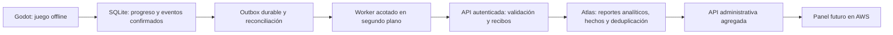

# Sincronización — Arquitectura vigente B05.4B sintética

**2026-10-28 Guatemala: receptor implementado y probado exclusivamente con identidades/datos sintéticos.** createApp permite composición explícita de JWTv2 y repositorio coordinado para /api/v2/sync/batches y /receipts/query. No se activa en defaultapp/server ni conecta videojuego, SQLite real, Mongo o Atlas.

Repositorio abstracto en src; adaptadores de memoria y snapshot cifrado bajo tests/sync. Una operación confirma hecho/recibo juntos; heads se derivan de hechos únicos bajo exclusión común, sin contadores incrementales. Mutaciones de identidad sintética comparten coordinador con ingestión; token verificado y cuenta/sesión/binding/épocas se revalidan dentro de la aceptación. Hash y scope no proceden de confianza ciega en JSON. Cuatro tipos, bytes/sobre1 y fuentes existentes intactos.

Pruebas:63vectores C# reales compatibles;67nuevas+124regresiones backend=191;64regresiones C# Outbox adicionales;255aprobadas,0fallidas finales. Reinicios HTTP en procesos independientes, concurrencia, ACK perdido, revocación y crash probados solo en fixtures. Maestro de cifrado solo RAM/IPC; crash deja lock residual y503, no se borra automáticamente. No prueba Mongo, apagón, varios hosts o recuperación tras perder el orquestador.

[Detalles de implementación y garantías](B05_REMOTE_INGESTION_ARCHITECTURE.md), [pruebas T/V y adicionales](B05_REMOTE_INGESTION_TEST_PLAN.md). Las906pending/889fuentes de E.2 siguen siendo antecedente, no un nuevo conteo SQL en B. Datos protegidos intactos, B00 pendiente. B05.4C no iniciada. Los bloques A/históricos siguientes conservan decisiones previas y no sustituyen este estado.
# Sincronización — Arquitectura y estado vigente B05.4A

2026-10-28, America/Guatemala. **Auditoría/diseño completados; recepción remota no implementada.** [Contrato del receptor](B05_REMOTE_INGESTION_ARCHITECTURE.md), [API vigente de diseño](B05_SYNC_API_CONTRACT.md) y [plan de pruebas](B05_REMOTE_INGESTION_TEST_PLAN.md).

| Capa | Estado actual verificado en archivos |
|---|---|
| Godot/SQLite |B05.3 completada en su alcance local. Última auditoría E.2:906pending,889/889fuentes actuales,0faltantes; antecedente, sin nueva consulta SQL en A. No enviar operaciones reales.|
| Backend |Express, Argon2id, jose/RS256 y Zod instalados. JWTv1/memoria y JWTv2/repositorio async activables por composición aislada; defaultapp/server no habilitan v2/sync ni producción.|
| Identidad durable de ensayo |Adaptador sintético cifrado y fixtures, bajo tests; no Mongo/Atlas productivo ni custodia/recuperación de usuario ya resuelta.|
| Receptor |Diseño POST `/api/v2/sync/batches`, carrier de transporte2 conserva sobre1; no código/endpoint existente. JWTv2 y middleware de contexto desde repositorio, sin confiar en UUID del JSON.|
| Persistencia/efectos |Repositorio abstracto a implementar; transacción por operación para hecho único, heads y recibo, dedupe/concurrencia y fence con revocación. Fake primero; Mongo requiere puerta separada.|
| Recibos |Núcleo durable separado del intento local; respuestas individuales/207parcial, no ACK global. Confirm actual es simulación estructural, no autenticación de una respuesta de red.|

No duplicar una decisión/resultado en otros tipos ni sumar telemetría de completion como otro bioma completado. Operación recibida y hecho fuente tienen identidades distintas; proyecciones/head son referencias a hechos únicos. Conservar tiempo medido/unknowns, revisión máxima y límites de confianza de un cliente modificable. SQLite sigue siendo autoridad para jugar; remoto solo analítica.

Brechas de activación: canon byte-a-byte C#/Node pendiente, transporte/ACK y binding cliente no implementados, contexto autenticado sin binding expuesto, repositorio/índices/transacciones Mongo ausentes y seguridad B00/custodia pendientes. No cambiar Outbox ni activar conexiones para resolverlas en A. B05.4B requiere autorización; no HTTP/Atlas/AWS.

## Archivo histórico B05.1–B05.3

Las secciones siguientes preservan los hallazgos de su fecha, no niegan la Outbox local ya implementada ni constituyen permiso para endpoints. Para recepción prevalece B05.4A enlazada arriba.

# B05.1 — Arquitectura de sincronización global (histórico)
2026-10-27 · Auditoría/diseño únicamente. Ninguna conexión, migración o implementación autorizada por este documento.

## Estado real inspeccionado
| Componente | Hecho actual y evidencia |
|---|---|
| API | backend/src/app.js: Express5.3.0; GET /api/health, POST /api/identity/register, POST /api/auth/session, GET /api/identity/me y404. server.js escucha127.0.0.1, cierre controlado; config/server.js solo HOST/readPort. No carga .env. |
| Estructura | src/config, database/mongodb, middleware, modules/auth, modules/identity, utils. routes/controllers/services/models/middlewares/domain no existen como carpetas de esta API; no confundir singular middleware con ausencia de controles. database/mongodb contiene únicamente .gitkeep. |
| Autenticación | Argon2id mediante @node-rs/argon2 2.2.2; sesiones opacas900s, hash SHA-256 del token,3 sesiones por cuenta, revocación interna y credentialVersion. Cuenta/registro/sesión/limitador son Maps de proceso: sin durabilidad ni soporte multiinstancia. |
| Seguridad | Validadores manuales de campos/UUID/credencial; JSON8KiB sin compresión, headers/error sanitizado, cuotas/rate limits y WorkPool Argon2 de2 trabajos/cola8/espera2s. No Zod, JWT, Mongoose, roles player/admin, login administrativo o modelos User/GameProgress/Decision/PlaySession reales. |
| Cobertura | Tests unit/app, unit/identity-auth e integration/identity-api cubren contratos, Argon2, pool, idempotencia de registro en proceso, expiración/revocación, límites y errores. Son código inspeccionado, no tests ejecutados en B05.1. Un nombre de test “no hay rutas ... B01” verifica rutas genéricas404; no niega las rutas de identidad específicas posteriores. |
| SQLite | Basev2 y extensión gameplayv1; autoridad de juego offline. Perfil/partidas/historia/decisiones/ambientes/operaciones, sesiones/eventos/intervalos y consultas tipadas funcionan. No tablas outbox, sync_queue, binding de instalación o ACK remoto implementados. |
| Cliente | GameApplicationContext._Ready compone solo GamePersistenceContext. Inicialización HTTP legado está fuera de ese arranque. PendingOperationStore es un journal JSON de comandos remotos con IDs24hex y expectedRevision; no es outbox UUID del runtime ni se puede importar como progreso. |
| Finales | E.2B.2 usuario confirma598 pruebas anteriores y12/12 manuales, cero errores nuevos. Evaluador local-ending-reject-count-1:5reject good;3/4medium;0–2bad. final_pending antes de presentación y completed/is_current0 al salir; conservar historia. No se reejecutó la validación. |

Fuentes locales: archivos anteriores, package.json; Models, SchemaManager, GameSaveService, SQLiteRepository, LocalFinalEvaluator, GameplayEventSchema/Models/Service/Repository, StatisticsService, LocalGameplayObserver, GamePersistenceAdapter/State y documentos IDENTITY_DESIGN/API_CONTRACT/AUTH_SECURITY_DESIGN, GLOBAL_STATISTICS_DESIGN y cierre E.2B.2. Comentario “B05 may add outbox” de UnitOfWork no acredita una cola.

## Arquitectura propuesta

SQLite manda sobre la partida; Atlas almacena una réplica analítica de datos permitidos, NO partidas cargables/checkpoints ni autoridad para continuar. Se envían decisiones y progreso mínimos como hechos/reportes, nunca snapshot_json de continuación, posición/recursos, manifiestos, rutas o secretos. Esto precisa el alcance histórico “estadísticas, no guardados”: no habilita cloud save.

Identidad y red no están en la cadena crítica FinNivel/decisión/final. Error de auth, API, Atlas o panel no cambia decisiones, gates, resultado o disponibilidad local. Worker independiente con cancelación, cuotas y un solo emisor por instalación. No await HTTP en callbacks de juego.

## Datos e identidades estables
| Fuente | Identidad disponible | Brecha |
|---|---|---|
| local_profiles | local_player_id UUIDv4; revision | installation_id y binding/version de sincronización no existen; campos registro/credential_ref son estructura, no flujo runtime implementado. |
| saved_games | game_id UUIDv4, revision, dueño, versiones | Captura analítica mínima versionada y ACK, sin copiar snapshot de reanudación. |
| environmental_decisions | decision_id/operation_id UUID, GameId/BiomeId/key/order | Unicidad remota lógica por partida/bioma/key; consecuencias verificables permitidas. |
| biome_progress | (GameId,BiomeId), estado/fechas/result | No necesita UUID artificial por fila; revision proviene del reporte de partida. |
| local_operations | operation_id/digest/kind/receipt | Guarda digest, no payload completo; no sirve como log exportable de todas las transiciones. |
| gameplay_sessions | session_id UUID, estado/open/closed/interrupted | Sin revisión de fila; reportes open/terminal con clave natural y orden monotónico. |
| gameplay_events | event_id UUID; run y dedupe_key | Preservar contrato/tipo/offset; eventos anteriores a captura siguen desconocidos. |
| gameplay_intervals | interval_id UUID y límites monotónicos | No recomputar por timestamps de guardados; validar no solapamiento. |

Tipos propuestos de sobre: game.report, session.report, gameplay.event, gameplay.interval. Un game.report incluye un snapshot ANALÍTICO coherente de las cinco filas, decisiones/consecuencias conocidas y metadatos finales al revision concreto; no es delta de contadores. Así decisión/ambiente/progreso/final de una revisión se validan juntos. session.report captura open o terminal: key natural SessionId+phase(open/terminal); terminal es closed o interrupted y solo una variante válida. Eventos originales siguen separados; no sumar reportes de sesión y SESSION_STARTED como dos sesiones.

## Outbox durable: propuesta de extensión separada
No existe un contrato previo de cola runtime que obligue a reutilizar nombres. Proponer extensión syncv1 sobre basev2/gameplayv1, con su propio historial/checksum; no editar migraciones anteriores ni subir user_version por inferencia. Necesita autorización de DDL y de ruta antes de aplicarse; runtime protegida no se migra en B05.1.

sync_installation(installation_id UUID, local_player_id, created_at_utc, binding_generation, remote_account_id opcional); sync_outbox(operation_id UUID PK, owner, installation_id, binding_generation, game_id opcional, type, contract_version, source_key, canonical_payload, payload_hash, created_at_utc, state, attempts, next_attempt_utc, lease_owner, lease_until_utc, received_receipt_json, last_error_code), UNIQUE(owner,installation_id,binding_generation,source_key); sync_checkpoints por fuente/cursor/revisión+digest. Sin tokens/credencial en payload. Rotación de credencial conserva binding/IDs pendientes; cambio de propietario/binding requiere reconciliación aprobada antes de reenviar, nunca cambiar el payload bajo el mismo OperationId.

source_key: game:GameId:revision; session:SessionId:open|terminal; event:EventId; interval:IntervalId. Conservar OperationId por source_key/digest; capturar proyección inmutable al insertar. Otro digest para la misma clave es conflicto, no overwrite. UUID de cola distinto del eventId original, ambos estables; ACK por OperationId.

Estados elegidos: pending, in_flight, confirmed, retryable_failure, permanent_failure. No mezclar registrationStatus ni estados de gameplay. Transiciones: pending/retryable→in_flight mediante lease transaccional; respuesta durable→confirmed; temporal→retryable con nextAttempt; inválido/contradictorio→permanent (cuarentena conservada). Lease vencido tras crash vuelve a retryable, no “entregado”. Attempts aumenta al tomar envío; ningún ACK parcial confirma todo el lote.

No hacer que disco/cuota de outbox revierta CompleteBiome: reconciliador lee fuentes DURABLES después del commit, inserta intención+checkpoint de captura en una transacción separada y puede repetir escaneo. Ventana después de dominio/antes de captura se recupera desde filas actuales e IDs. No promete cada revisión intermedia si no se archivó su proyección: cambios aún no capturados se compactan solo para estado analítico de partida, no para hechos/eventos. Operaciones confirmadas capturadas no se reescriben. Mantener fuentes de eventos/intervalos hasta captura/retención autorizada; sin borrado actual.

No reconstruir eventos que nunca fueron guardados: laguna E.2A entre completion y telemetría se informa como progreso confirmado con evento faltante. Un reporte de partida sí acredita completed sin fabricar run/tiempo. Reconciliación de outbox (copiar hechos existentes) no equivale a reparar esa laguna.

## Orden, historia y consistencia
1. Registro/asociación autenticada y binding de IDs, sin bloquear juego.
2. game.report crea/actualiza partida+cinco biomas+decisiones/ambientes/final/cierre de una revisión coherente. Identidad se deriva del token; actor local debe estar ligado.
3. session.report open (puede no pertenecer a una sola partida).
4. ANIMAL_SEGMENT_STARTED/eventos de sesión requeridos; después eventos que referencian run.
5. Intervalos con sesión/run existentes; reportes terminales/eventos finales cuando estén sus prerrequisitos.
6. Revisiones siguientes de game.report reflejan final_pending/cierre; no necesitan llegada de toda la telemetría para aceptar progreso.

Diferir por dependency_missing con referencias exactas, no aceptar para agregar algo incompleto. Reporte terminal de sesión puede llegar antes que intervalos: almacenar endOffset pero no rechazar automáticamente intervalos tardíos válidos <=endOffset; revisar cobertura tras entrega. Orden por offset/session/run, nunca hora de llegada. No imponer que el ordinal del bioma sea secuencia.

Historial existente: escaneo paginado readonly por perfil dentro de snapshots coherentes, con checkpoints durables y clave source_key; origen historical_import, cobertura explícita. Se pueden enviar partidas cerradas o activas tal como se encuentran, sin simular las revisiones ausentes ni transiciones humanas. Versiones/casos históricos incompatibles quedan en cuarentena, sin alterarlos. Ya existen UUIDs; no reasignarlos al migrar. No abrir ni adoptar las bases sintéticas históricas AppData para el worker runtime.

## Recepción remota e idempotencia
Modelo propuesto: TechnicalAccount, InstallationBinding, SyncReceipt, GameReportRevision+GameProjection, DecisionFact, SessionReport/SessionProjection, GameplayEventFact, GameplayIntervalFact. Son nuevos, no los antiguos User/GameProgress/Decision/PlaySession “conectados”.

Claves únicas de recibo (accountId,installationId,operationId); binding local único por accountId+installationId+localPlayerId. Claves de hechos además de UUID: partida accountId+GameId+revision; decisión accountId+GameId+BiomeId+decisionKey; evento accountId+EventId y accountId+run+kind según contrato; intervalo accountId+IntervalId y session/rango/state. Detectar mismo UUID de GameId copiado entre instalaciones con identidad de fuente incompatible; no sumar ni fusionar por nombre. Un jugador en varias máquinas no tiene sincronización bidireccional aprobada: binding de fuente única por partida salvo futura transferencia explícita.

Comparar hash CANÓNICO del payload exacto: igual→recibo existente; diferente→409 permanent conflict. Entrega al menos una vez cuando el cliente puede reintentar; efectos idempotentes, nunca “HTTP exactamente una vez”. Recibo+hechos/proyección se confirman en una transacción MongoDB con readConcern snapshot/writeConcern majority acordados; ACK solo después de commit durable. Si commit es incierto, resolver por recibo antes de reenviar/modificar. No usar incremento de contadores externo al commit ni TTL que borre la deduplicación antes de posibles retries.
MongoDB documenta atomicidad por documento y transacciones multidocumento; los índices únicos imponen unicidad de claves compuestas. Son capacidades a validar en fixtures, no una conexión existente. [Transacciones](https://www.mongodb.com/docs/manual/core/transactions/), [índices únicos](https://www.mongodb.com/docs/manual/core/index-unique/).

Revision vieja: validar y archivar recibo/revisión como superseded sin degradar proyección; mismo GameId/revision con datos distintos→conflicto. Como cada reporte es autocontenido, se admite salto de revisión; no se inventan hechos intermedios. Cierre consistente requiere cinco completed/decisiones y ending de versión reconocida; telemetría parcial no lo impide. Limitar revisión/fechas plausibles sin “corregir” decisiones.

## Fallos y recuperación
| Caso | Conducta |
|---|---|
| Una entrega / duplicado / respuesta perdida | Inserción y recibo durables; retry mismo ID devuelve mismo efecto, sin recuento doble. |
| Reinicio cliente/Windows | Recuperar lease/checkpoint; mismo payload/ID; no cerrar partida local. |
| Fuera de orden | game.report por revisión autocontenida; dependencias de evento/run se difieren y reenvían. |
| Misma clave con carga distinta |409, cuarentena permanente y diagnóstico seguro, no overwrite. |
| API offline/timeout/5xx/Atlas inaccesible | Backoff exponencial con jitter, máximo15min propuesto; Retry-After prevalece. Base local sigue jugable. |
|401 | Una reautenticación acotada; revocación/credencial fallida pausa sync en RECOVERY_REQUIRED, no gameplay. |
| Disco lleno/outbox llena | No borrar ni bloquear dominio por la cola; diagnóstico y detener captura/envío, retomar desde fuente. Disco lleno de la propia DB puede impedir guardar y sigue el error local existente; no prometer inmunidad al fallo físico. |
| Cierre durante ACK local | ACK no persistido→reenvío idéntico. Sin rollback distribuido con Atlas. |

Worker propuesto1 lote activo, timeout15s, máximo100 operaciones/256KiB, pausa/cancelación al salir y budget de captura limitado. Sin loop de reintento en frame. Retención/consentimiento/borrado remoto y cotas globales se aprueban antes de producción; no purgar permanent_failure ni recibos por “limpieza”.

Riesgos: cliente modificable puede reportar datos falsos; servidor valida consistencia, no prueba que se jugó físicamente. IP/NAT/instalaciones duplicadas/rollback de backup comprometen dedupe si cambia identidad. Contadores administrativos deben declarar “reportados/validados estructuralmente”, no verificados antitrampas. Ver planes de identidad, API, métricas y roadmap.

## B05.3A — Outbox SQLite sintética (2026-10-27 Guatemala)

Ahora existe extensión local sync v1 opt-in sobre base2/eventos1, únicamente migrada en bases sintéticas. Captura tipada de fuentes, filas inmutables/dedupe, leases/reintentos/ACK simulado. No worker, HTTP, receptor ni hooks de gameplay. CaptureInTransaction permite compartir conexión/tx y se probó solo en fixtures. Reconciliación automática/checkpoints y atomicidad del gameplay real siguen pendientes B05.3B; no hay sync_checkpoints creada sin uso. El antecedente que indicaba ausencia de Outbox describe B05.1, no este estado.

Contrato, tablas, transiciones, operaciones, limitaciones, pruebas, inventario y plan runtime en [B05_LOCAL_OUTBOX_IMPLEMENTATION.md](B05_LOCAL_OUTBOX_IMPLEMENTATION.md). No inicia B05.3B ni autoriza tocar runtime, HTTP o Atlas. B00 sigue pendiente; sin cambios ACL/propietario/herencia.

## B05.3B.1 — Captura y reconciliación sintéticas (2026-10-28 Guatemala)

La reconciliación sintética tiene dos etapas paginadas (fuentes y auditoría de cola), savepoint por candidato y transacción de página para filas/DAG/binding local. Cursor reanudable NO es checkpoint durable ni ACK: reiniciar desde null es idempotente y pasadas completas detectan cambios detrás del cursor. PreviousIssues impide que una última página limpia oculte incidencias anteriores. No perfil remoto, JWT o HTTP para insertar hechos locales. Fuente no confirmada/telemetría perdida no se fabrica; no atomicidad integral gameplay–Outbox ni conexión runtime.

Matriz de hechos, métodos/archivos, garantías, historial, pruebas, limitaciones y plan preciso B05.3B.2 en [B05_OUTBOX_CAPTURE_RECONCILIATION.md](B05_OUTBOX_CAPTURE_RECONCILIATION.md). B00 continúa pendiente. Detenido; sin iniciar B05.3B.2/B05.4.
