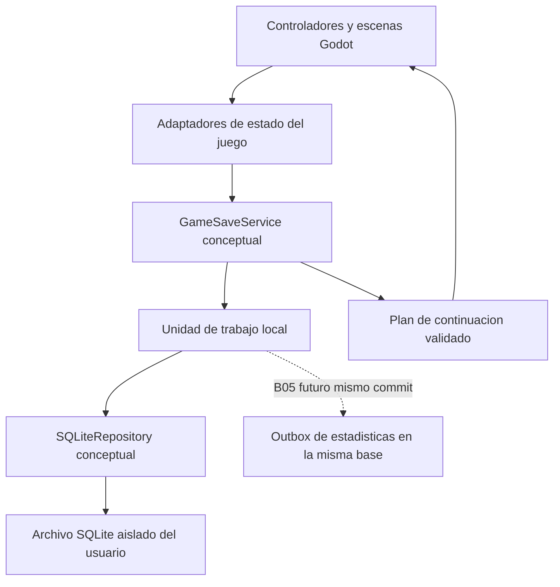

# B04.1 — Contratos conceptuales de persistencia local

Fecha: 2026-10-25, America/Guatemala. Estado: DISEÑO PROPUESTO, sin código C#, driver, SQL ejecutado o base real. [SQLITE_SCHEMA_DESIGN.md](SQLITE_SCHEMA_DESIGN.md) define evidencia, tablas y decisiones pendientes. Estos contratos son llamadas locales entre capas del cliente; NO endpoints HTTP ni servicios Node que abran archivos del jugador.

## Capas y responsabilidades



GameSaveService valida el agregado y reglas de dominio; repository parametriza consultas y aplica transacciones. Proveedor de ruta verifica aislamiento; gestor de versiones/migraciones controla compatibilidad; adaptadores capturan/aplican DTO sin referencias a nodos o secretos. C# trabaja con una cola de escritura acotada fuera del frame principal; capturar/aplicar estado y cambiar escenas se hace en el hilo Godot. No compartir objetos Node o conexiones sin coordinación entre hilos, no poner SQL en personajes/NPC/biomas y no esperar internet para guardar.

Los nombres de interfaces/clases de esta sección son propuestas nuevas. No se crea GameSaveService, no se modifica GameApplicationContext ni se ejecuta el motor en B04.1. El backend B03.2 permanece íntegro, en memoria y sin progreso remoto.

## Tipos conceptuales y resultados

- `Profile`: localPlayerId, displayName, revision, fechas y asociación técnica no secreta/registrationStatus. Un único perfil por archivo; nombre no único y editable.
- `GameSave`: gameId UUID local, owner local, revision, versiones de guardado/reglas/contenido, status, biomas, decisiones, ambiente y continuación. No contiene tokens, hashes o contraseñas.
- `ResumePoint`: resumeKind, biomeId si corresponde y checkpointKey de catálogo. La perspectiva se deriva: human_decision es humana; animal_start/animal_checkpoint es animal; menu/info/ending son presentación. No inferir bioma o ambiente desde una variable global desactualizada.
- `SaveCommand`: operationId UUID estable, localPlayerId, gameId si corresponde, expectedRevision y cambios/captura. Guardar los mismos identificadores en un reintento. Para perfil se usa su revision; partida y perfil no comparten contador.
- `SaveReceipt`: operationId, gameId cuando corresponde, committedRevision y committedAt. Confirma solo persistencia local; no registro remoto, sesión o sincronización.
- Resultado de lectura: datos inmutables/versionados o error tipado. Perfil ausente devuelve ausencia explícita, sin crear otro silenciosamente. Recuperación usa un resultado separado con opciones, nunca devuelve defaults como si fueran datos cargados.

Formato conceptual de resultado: éxito con datos/recibo o fallo con code, retryable y estado de commit NOT_COMMITTED/UNKNOWN. No stack, SQL crudo, ruta privada completa ni secretos en mensajes de UI. Los nombres JSON de ejemplo son DTO propuestos, no nuevas propiedades comprobadas del código actual.

## Operaciones y contratos

| Operación conceptual | Entradas | Salida / transacción | Validaciones y errores específicos |
|---|---|---|---|
| CreateLocalProfile | operationId, localPlayerId, displayName normalizado | Profile y recibo; insertar singleton y recibo juntos | Si existe perfil distinto: PROFILE_ALREADY_EXISTS, no reemplazo; repetición de misma operación devuelve recibo |
| GetLocalProfile | Contexto de archivo aislado | Profile o ausencia, sin red | Error de compatibilidad/integridad no se trata como perfil inexistente |
| UpdateDisplayName | operationId, localPlayerId, expectedProfileRevision, nuevo nombre | Profile revision+1 y recibo | Reglas Unicode B02/B03; no cambiar cuenta, gameId o eventos. Nombre igual puede ser no-op con recibo sin revisión adicional |
| CreateNewGame | operationId, localPlayerId, expectedCurrentGameId/revision si existe, nuevo gameId y catálogo aprobado | Partida actual revision 0, biomas/ambiente iniciales, snapshot y recibo en un commit | Reemplazar partida actual requiere intención explícita; archivar anterior preservando datos. UNIQUE parcial evita dos actuales |
| SaveCurrentGame | operationId, localPlayerId/gameId, expectedRevision, ResumePoint y captura válida con cambios | Agregado persistido, revision+1 y recibo, todo o nada | Rechazar captura parcial/incompatible, bioma desconocido o modificación de propietario; no sobrescribir una revisión más nueva |
| LoadGame | localPlayerId, gameId | Agregado completo consistente y revisión | Comprobar propietario, versiones, FK lógicas, cinco biomas del catálogo de esa versión, revisión de snapshot y payload; no autorizar por cuenta remota |
| RecordDecision | operationId, decisionId estable, localPlayerId/gameId, expectedRevision, biomeId, decisionKey, optionId | Historial + consecuencias + ambiente/progreso + continuación + recibo; B05 añade evento en mismo commit | Validar par bioma/decisión/opción y etapa, calcular consecuencias solo por reglas conocidas. Reintento no genera otra decisión |
| GetDecisions | localPlayerId/gameId, filtro biomeId opcional, cursor de orden y límite | Página ordenada por decision_order, no por reloj | Límites propuestos 1–100; sin escribir ni reconstruir decisiones ausentes |
| UpdateEnvironmentalState | operationId, juego/propietario, expectedRevision, cambio de dominio con versión | Nueva proyección + snapshot/progreso afectados + recibo en mismo commit | No permitir patch arbitrario que contradiga la decisión vigente; corrección/mecánica solo si regla aprobada la define |
| GetBiomeProgress | localPlayerId/gameId y biomeId opcional | Progreso, objetivos reconocidos y ambiente; tarjeta/disponibilidad derivadas | Nunca usar el booleano global como fuente de todo el historial; UNKNOWN_BIOME si no está en catálogo |
| ContinueGame | localPlayerId y gameId explícito o selección de actual | Agregado + plan de escena/checkpoint, sin HTTP | No alterar progreso por consultar. UNKNOWN_CONTENT/UNSUPPORTED_CHECKPOINT si falta contenido; no saltar a otra escena silenciosamente |
| RestartAnimalSegment | operationId, juego, expectedRevision, biomeId, motivo death/voluntary | Nuevo intento/checkpoint animal; conservar decisión/ambiente y recibo | Solo etapa animal válida; reset explícito de recursos/posición a valores de contenido, sin borrar decisiones ni completar bioma automáticamente |
| CompleteBiome | operationId, juego, expectedRevision, biomeId, logro verificado | completed/result/hitos y posible final_pending + recibo | Regla de finalización y evaluación global pendientes de S04; sin umbrales inventados |
| Get/SetLocalSetting | propietario, clave permitida; Set añade operationId/valor/version y revisión de perfil esperada | Preferencia validada y recibo para Set | No aceptar claves de conexión/credenciales; no ejecutar configuración proveniente de JSON |

Estas son operaciones de dominio, no SQL público. RecordDecision/UpdateEnvironmentalState/CompleteBiome delegan en una misma unidad de trabajo interna; no encadenar tres commits independientes desde la escena. No ofrecer una API que permita guardar una decisión y olvidar sus consecuencias.

### Validación de nombre y pertenencia

Reutilizar conceptualmente normalización NFC, trim, límites de 1–32 grafemas y 256 bytes y rechazo de controles/bidi/Unicode mal formado definidos en B02 y probados por helper B03.2; se necesita implementación compatible en C# y corpus compartido antes de usarlo. No llamar al backend para validar unicidad. Todos los gameId consultados deben pertenecer al singleton local; technicalAccountId no concede acceso local ni reemplaza localPlayerId. Comprobar tanto propietario como revisión en lecturas/escrituras.

### Transacción conceptual de guardado

1. Capturar DTO inmutable en un punto seguro de Godot; generar operationId/decisionId/eventId necesarios antes de encolar y conservarlos hasta resolver resultado.
2. En trabajador escritor, iniciar transacción local, comprobar recibo por operationId. Mismo digest/propietario/operación: devolver recibo; distinto contenido: OPERATION_CONFLICT.
3. Cargar estado/revisión y comprobar expectedRevision, propiedad, catálogo y punto. Calcular cambios validados; reservar decision_order bajo esa transacción.
4. Insertar recibo, decisión y proyecciones/progreso/objetivos/captura pertinentes; incrementar una vez revision y guardar la misma capturedRevision. B05 insertará aquí el evento pendiente en la misma conexión/transacción.
5. Commit. Solo después emitir SaveReceipt y notificación de UI/cambio de escena. Fallo previo: rollback integral. No hacer HTTP, esperar animaciones o DPAPI dentro de la transacción.
6. Si la confirmación local se perdió después de commit, consultar/repetir con misma operación; no generar nuevo ID y no volver a aplicar consecuencias. Si ya hay cambios posteriores, devolver recibo original y cargar estado actual aparte, sin bajar revisión.

Para crear el primer perfil, insertar el perfil y su recibo en el mismo commit (el recibo refiere al perfil ya insertado). En decisión, insertar primero el recibo transaccional para satisfacer FK; si algo falla todo revierte, por lo que nunca queda recibo de una operación incompleta. El digest se calcula sobre datos canónicos de la operación excluyendo metadata transitoria; no contiene contraseñas ni tokens. Propuesta de canonicalización: campos definidos/versionados, orden de claves fijo, tipos y unidades inequívocos; concretar antes de implementar para no confundir reintentos equivalentes con cambios.

Al crear partida, insertar primero el padre saved_games y luego su recibo/filas dependientes, todo en ese mismo commit; no insertar un recibo que refiera a una partida aún inexistente con FK inmediatas. El orden interno de inserción respeta las relaciones, sin exponer estados intermedios como guardados confirmados.

## Qué guardar y qué reconstruir

Guardar: perfil; decisión elegida y orden; estado por bioma/objetivos/hitos; estado ambiental reconocido y extensiones versionadas; versión de reglas/contenido; punto de continuación; actor/recursos/objetos cuando el modo de checkpoint los soporte; configuración local permitida. B05: tiempo, eventos y estado de envío por separado.

Reconstruir desde contenido y estado: fondos, partículas, visibilidad Buen estado/Mal estado, texturas de tarjetas, HUD y multiplicadores derivados. No guardar Godot Node, Tween, señales, IDs de instancia runtime, colisiones, HTTP clients o token. Position/CurrentHealth/Agua/Comida no se deben descartar si se ofrece restauración exacta; su ausencia obliga a declarar un checkpoint de inicio de segmento, no restauración precisa.

## Política de continuación propuesta y límites reales

Base recomendada para primera implementación: autosave en límites de segmento, después de decisión humana, antes de iniciar tramo animal, al completar bioma y al fijar/leer final. No esperar red ni confirmación remota. Conservar si debe verse todavía la información educativa mediante resume_kind=decision_info; no duplicar la decisión al volver a abrirla.

Un checkpoint animal exacto necesita capturar vida, recursos, posición segura y estado persistente de fuentes/objetos para evitar recolección doble. `_dropeados`/`_recogido` existen, pero no hay IDs duraderos para esos objetos ni un contrato de restauración en los scripts inspeccionados; las propiedades públicas CurrentHealth/Agua/Comida tienen setters privados. B04.2 deberá definir adaptadores e identificadores estables con autorización de C#, o limitar explícitamente el alcance a inicio de segmento. No restaurar solo al jugador y regenerar recursos como si fuera el mismo mundo.

Si el usuario pide un guardado exacto que no se puede representar, UNSUPPORTED_CHECKPOINT y ninguna escritura. Ofrecer reinicio explícito del segmento con ambiente/decisión conservados solo cuando la política esté aprobada; no hacer fallback silencioso. En una derrota, no tratar CurrentHealth=0 como un checkpoint jugable normal; registrar resultado/reinicio según la regla aprobada. La pausa temporal del árbol no se persiste como obligación de reabrir el juego congelado.

### Plan de carga Godot

1. Abrir ruta aislada y comprobar integridad/versiones sin requerir SessionManager o red. Obtener perfil/partida actual.
2. Leer todo el agregado en una vista consistente. Validar catálogo, punto y coherencia de ambiente/etapa/resultado.
3. Resolver escena con catálogo aprobado (tabla comprobada en SQLITE_SCHEMA_DESIGN); no ejecutar una ruta arbitraria desde DB. Validar que exista contenido compatible antes de alterar la escena actual.
4. Para destino animal aplicar estado ambiental del bioma al adaptador legado `VariablesGlobales.BiomaSaludable` ANTES de instanciar escena/Ready. No convertir ambiente NULL de human_pending a «healthy» por comodidad.
5. Instanciar y restaurar el estado de captura con un protocolo de inicialización que evite que Ready sobrescriba valores; hidratar también recursos/objetos si es checkpoint exacto. Recién entonces habilitar input/física. El punto correcto requiere implementación posterior; no basta llamar setters hoy inexistentes.
6. Si falla presentación tras commit, mantener guardado e intentar de nuevo el mismo plan; no recalcular ni reenviar decisión. Sesión remota expirada solo afecta sincronización futura.

El código actual MenuPrincipal/DecisionSceneFlow/AnimalSegmentFlow/menús protegidos usa autoridad remota; no puede conectarse a este diseño simplemente cambiando una URL. B04.2 debe especificar qué archivos modifica y B08 integrará el cliente autorizado. B04.1 no prueba ni habilita jugar offline en el ejecutable actual; define una arquitectura que lo permitirá tras implementación.

## Errores y recuperación

| Código local | Tratamiento |
|---|---|
| PROFILE_ALREADY_EXISTS / NOT_FOUND | No crear/reemplazar silenciosamente; distinguir ausencia válida de corrupción |
| INVALID_NAME / INVALID_DATA / UNKNOWN_BIOME | Rechazar antes de escribir; corregir entrada sin perder último guardado |
| REVISION_CONFLICT / OPERATION_CONFLICT | No sobrescribir; consultar recibo/estado y resolver comando; no adaptar revisión automáticamente |
| UNSUPPORTED_SCHEMA / UNKNOWN_CONTENT / UNSUPPORTED_CHECKPOINT | Preservar archivo y explicar compatibilidad o alcance; no reset automático |
| STORAGE_BUSY | Espera/reintento acotados por operación original, fuera del frame principal |
| DISK_FULL / ACCESS_DENIED / IO_ERROR | No confirmar guardado; conservar último commit, cambios en memoria si posible y estado de error honesto |
| COMMIT_UNKNOWN | Consultar local_operations antes de repetir; misma operationId y payload |
| CORRUPT_STORAGE / INVALID_SNAPSHOT | Suspender escritura; proponer comprobación/restauración de copia coherente sin borrar original |

Ningún error de almacenamiento local produce llamada Atlas para «cargar respaldo». Antes de migrar/restaurar, validar copias y versiones, informar fecha de recuperación y posible pérdida posterior. Si ya se reportó commit y falla un respaldo auxiliar, no anunciar que la transacción falló: guardado válido con advertencia BACKUP_UNAVAILABLE separada. No prometer recuperación ante pérdida física del disco.

## Integración futura con estadísticas B05

Definir un punto de extensión transaccional interno, no un evento en memoria posterior al commit. El comando de decisión produce cambios y descripción de evento sin datos personales; B05 añadirá inserción de outbox dentro de la misma unidad de trabajo SQLite. Perfil/decisión/gameId permanecen locales; los datos enviados serán mínimos del contrato estadístico aprobado, nunca snapshot_json/guardados completos.

Si insertar outbox falla una vez integrada B05, rollback también del progreso/decisión; si la red falla después, el commit local permanece y el evento queda pendiente. La sesión no es una condición del commit. Un eventId estable identifica el mismo evento en reintentos/reinicio; la confirmación estadística debe coincidir con evento/cuenta y persistencia remota antes de marcar sincronizado. Especificar payload, frecuencia y asociación a cuenta en B05/B07, no implementarlos aquí.

## Ejemplos sintéticos de contrato, no datos de juego existentes

Extracto sintético de continuación al inicio del tramo animal: no es un agregado completo cargable (omite biomas/decisiones/ambiente). Los IDs de checkpoint y versiones son marcadores, no contenido registrado ni resultados calculados por B04.1:

```json
{
  "gameId": "00000000-0000-4000-8000-000000000010",
  "localPlayerId": "00000000-0000-4000-8000-000000000002",
  "revision": 1,
  "saveFormatVersion": 1,
  "rulesVersion": "SYNTHETIC-RULES-VERSION",
  "contentVersion": "SYNTHETIC-CONTENT-VERSION",
  "status": "in_progress",
  "resumePoint": {
    "resumeKind": "animal_start",
    "biomeId": "ocean",
    "checkpointKey": "SYNTHETIC-SEGMENT-START"
  },
  "snapshot": {
    "capturedRevision": 1,
    "payloadVersion": 1,
    "data": { "mode": "segment_boundary" }
  }
}
```

Recibo ilustrativo de persistencia local:

```json
{
  "operationId": "00000000-0000-4000-8000-000000000020",
  "gameId": "00000000-0000-4000-8000-000000000010",
  "committedRevision": 1,
  "committedAt": "2026-10-24T12:00:00Z"
}
```

Error ilustrativo, sin SQL/rutas privadas:

```json
{
  "code": "REVISION_CONFLICT",
  "retryable": false,
  "commitState": "NOT_COMMITTED"
}
```

## Verificación futura B04.2

Antes de implementar: aprobar S01–S08 aplicables, rutas/namespace de pruebas, política de checkpoints y alcance C#. Probar perfil único, nombre actualizado sin cambiar dueño, nueva partida/archivo histórico, revisión y reintentos, relación decisión/ambiente/progreso, cargas offline con token vencido, caída en cada frontera de commit, conflictos/escrituras simultáneas, disco lleno/IO/lock, corrupción, migración desde versiones temporales, versión futura rechazada, contenido ausente y futura atomicidad con outbox. Usar solo bases temporales aisladas autorizadas, nunca datos reales del original.

Las 39 regresiones actuales de Node comprueban B01/B03.2, NO SQLite o Godot. No crear tests de SQLite ahora ni presentar verificación de diseño como prueba de persistencia implementada. B04.2 no comienza sin autorización explícita.
