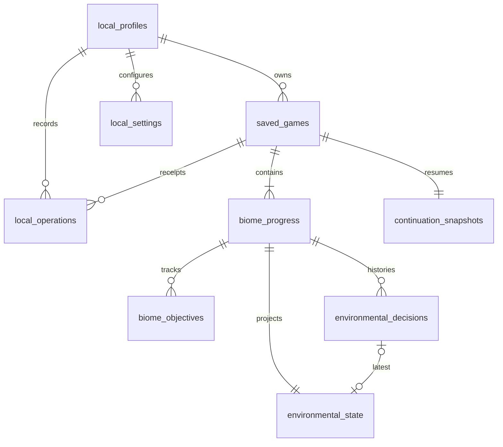

# B04.1 — Diseño del esquema SQLite local

Fecha: 2026-10-25, America/Guatemala. Estado: PROPUESTA DOCUMENTAL, NO IMPLEMENTADA. No se creó/abrió una base SQLite, instaló driver ni modificó Godot. Los contratos están en [LOCAL_SAVE_CONTRACT.md](LOCAL_SAVE_CONTRACT.md). Los nombres snake_case siguientes son columnas propuestas, no propiedades que ya existan en C#.

## Autoridad de requisitos y conflictos encontrados

Se examinó `docs/Requerimientos_Two_Sides_v6_corregido.docx` directamente como documento ZIP/XML, solo en memoria, sin extraer archivos. Se contrastó con las instrucciones actuales y las fases B00–B03.2. Ante conflicto, prevalecen las instrucciones actuales del usuario; el documento original permanece sin modificaciones.

| Fuente histórica | Hallazgo | Tratamiento en esta reconstrucción |
|---|---|---|
| RF-001, guardado automático | Pide persistir bioma, recursos, decisiones y ambiente al completar segmento; también enviar progreso completo a AWS | Conservar autosave local; NO exportar guardados a Atlas. Solo identidad mínima y estadísticas por API |
| RNF-006, internet obligatorio | Impide iniciar/continuar offline y considera SQLite caché | Sustituido por requisito actual de internet opcional: SQLite es autoridad del progreso |
| RF-033 y RF-035 «JWT» | Cuenta con correo/contraseña del jugador y JWT | Sustituidos por nombre visible, identidad técnica y sesiones opacas B03.2; no persistir tokens en SQLite |
| RF-021, orden progresivo | Desbloqueo lineal de biomas | Código/documentación actual permiten cualquier bioma incompleto. La política local necesita confirmación; no inventar orden fijo |
| RF-015 frente a RF-031/RF-032 | Reinicio tras derrota conserva decisiones, pero final negativo también podría completar/bloquear tarjeta | Distinguir muerte/reinicio de finalización del bioma. Confirmar la condición exacta de final negativo antes de implementar reglas |
| RF-027/RF-028 y código de final | Final global según todos los biomas | Guardar resultado y versión de reglas cuando exista evaluador aprobado; no inventar umbrales good/medium/bad |

El DOCX contiene IDs duplicados: RF-035 nombra tanto JWT como dashboard; RF-036, rate limiting y bitácora. Hay referencias cruzadas a números que no coinciden con sus títulos. Citar ID MÁS título para trazabilidad, sin renumerarlo o corregirlo aquí. AWS, Android, login tradicional y antiguas dependencias remotas no amplían el alcance Windows/offline acordado.

## Evidencia del juego inspeccionada

| Archivos / símbolos reales | Hecho observado | Dato persistente o reconstruible |
|---|---|---|
| `scripts/globals/VariablesGlobales.cs` | `BiomaSaludable`; `TipoNivel` Oceano/Selva/Desierto/Bosque/Tundra; `_estadosNiveles` y `EstadoNivel` NoJugado/Bueno/Malo | Ambiente POR partida/bioma y avance. El booleano y diccionario estáticos son proyecciones, no almacenamiento duradero |
| `scripts/network/Contracts/GameContracts.cs`, `Progress/GameStateStore.cs` | GameDto/BiomeDto: Revision, SchemaVersion, RulesVersion, BiomeId, Status, EnvironmentState, Result, fechas y final. Validador antiguo requiere ID remoto de 24 hex y sesión verificada | Aprovechar conceptos, no IDs remotos ni autoridad de sesión. Nuevo game_id local UUID propuesto; no copiar validaciones antiguas |
| `Services/DecisionCatalog.cs`, `EnvironmentalDecisionService.cs` | Cinco decision keys; `OptionFor(true)` devuelve reject y false approve; el servicio espera confirmación remota | Guardar occurrence UUID, decision key, opción y orden local. La semántica ambiental pertenece a un catálogo de reglas local por aprobar |
| `DecisionNivel.cs`, `EnvironmentalDecisionNivel.cs`, `OceanDecisionNivel.cs`, `DecisionSceneFlow.cs`; `scenes/levels/DesicionNieve.cs` | Elección humana, pantallas informativas y transición; flujo actual bloquea por backend | Conservar decisión y punto antes/después de información; adaptar en fase futura, no trasladar bloqueo remoto al guardado |
| `scenes/levels/BiomaMar.cs`, `BiomaSelva.cs`, `BiomaDesierto.cs`, `BiomaBosque.cs`, `BiomaNieve.cs`; `scripts/AlgaEstado.cs` | Visibilidad de buen/mal estado, fondos, partículas y animaciones desde BiomaSaludable | Persistir healthy/degraded, reconstruir estas presentaciones; no serializar nodos/partículas |
| `PlayerDelfin.cs`, `PlayerMono.cs`, `PlayerOso.cs`, `PlayerRataCanguro.cs`, `PlayerZorro.cs` | CurrentHealth y MaxHealth; inicialización de vida; movimiento/daño con timers transitorios | Vida y posición si se aprueba checkpoint exacto; máximos/configuración y timers de animación se reconstruyen según modo |
| `Estadisticas.cs` | Agua/Comida, AguaMax/ComidaMax, DrenajeAgua/Comida, SetSalud, MultiplicadorVelocidad derivado | Agua/Comida y vida para snapshot exacto; velocidad/HUD se recalculan. Esta clase no es la telemetría B05 |
| `FuenteRecurso.cs`, `ItemRecurso.cs` | `_dropeados`, CantidadBuenEstado/MalEstado, `_recogido`, vida útil y objetos con física | Snapshot exacto requiere agotamiento/objetos relevantes con IDs estables hoy ausentes; no regenerarlos silenciosamente |
| `FinNivel.cs`, `AnimalSegmentFlow.cs`, `Services/AnimalProgressService.cs`; `assets/sprites/ui/GameOver.cs`, `MenuPausa.cs` | Finalización, restart death/voluntary, reinicio animal conservando ambiente; confirmación online bloqueante | Persistir estado de segmento, intento/checkpoint; reset explícito de recursos/posición sin borrar decisión |
| `MenuPrincipal.cs`, `MenuNiveles.cs`, `TarjetaNivel.cs`, `Progress/BiomeCardController.cs`, `globals/Transicion.cs` | Catálogo de escenas, menús y estados; aplica ambiente ANTES de instanciar destino; admisión remota actual | Reanudar con plan local validado y aplicar ambiente antes de Ready; textura/bloqueo de tarjeta derivados del progreso |
| `Final.cs`, `Services/EndingService.cs` | Presentan ending good/medium/bad recibido; no contienen umbrales de cálculo local | Guardar final evaluado con reglas conocidas y punto de lectura; no suponer fórmula de mayoría |
| `network/PendingOperationStore.cs`, `GameApplicationContext.cs`, `ConnectivitySupervisor.cs`, `GameApplicationServices.cs` | Journal JSON antiguo bajo user://pending-operations; conectividad/sesión bloquean operaciones | No abrir, importar ni borrar journal existente. Nueva outbox B05 será local/transaccional; integración anterior no es compatible automáticamente |

También se revisaron `docs/Progreso_Godot.md`, `Progreso_Animal_Godot.md`, `Decisiones_Biomas_Godot.md`, `Tarjetas_Biomas_Godot.md`, `Final_Global_Godot.md` como registros históricos. Sus referencias a backend anterior/client-checks no autorizan reutilización ni ejecución.

Hechos adicionales: `project.godot` declara `config/name="TwoSides"` y autoloads Transicion/GameApplicationContext. `TwoSides.csproj` usa Godot.NET.Sdk/4.6.1 y net8.0 en el destino habitual; la condición Android net9.0 no cambia el alcance Windows. Solo se leyeron esas claves, sin modificarlas. No existe una propiedad comprobada CurrentBiome en VariablesGlobales: el bioma actual se deduce hoy del catálogo/escena y deberá representarse explícitamente en el DTO local nuevo.

### Catálogo comprobado

| Bioma | TipoNivel | Decisión actual | Escena humana / animal bajo `res://scenes/levels/` |
|---|---|---|---|
| ocean | Oceano | ocean_waste_disposal | DesicionDelfin.tscn / bioma_mar.tscn |
| jungle | Selva | jungle_transport_route | DesicionMono.tscn / bioma_selva.tscn |
| desert | Desierto | desert_cat_abandonment | DesicionRataCanguro.tscn / bioma_desierto.tscn |
| forest | Bosque | forest_industrial_pesticides | DesicionZorro.tscn / bioma_bosque.tscn |
| tundra | Tundra | tundra_fossil_extraction | DesicionNieve.tscn / bioma_nieve.tscn |

La tabla procede del C# BiomeCardController/DecisionCatalog; no se editaron ni ejecutaron escenas para validarla visualmente. No inferir el animal instanciado únicamente del nombre de una escena. TipoRecurso incluye Calor, pero `Estadisticas.Recuperar` solo gestiona Agua/Comida: no se inventa una variable calor persistente.

## Convenciones y decisiones de esquema propuestas

- Un archivo SQLite aislado contiene un único perfil local, varias partidas históricas y como máximo una actual. Nuevos nombres no crean perfiles o identidades. No imponer unicidad al nombre.
- TEXT para UUID canónicos y tiempos UTC ISO 8601; INTEGER para booleanos 0/1, revisiones y orden. Validar límites/unidades en servicios; no confundir longitud SQLite de caracteres con grafemas Unicode.
- Ninguna contraseña, verificador Argon2, token Bearer ni correo personal. `credential_ref` apunta a almacén protegido Windows separado; el backend no abre SQLite del jugador.
- Biomas y objetivos se validan contra catálogo versionado de contenido/reglas, no contra nombres de nodos arbitrarios o un enum SQL cerrado que impida agregar biomas. Los cinco actuales se crean como filas de progreso por partida.
- PK/FK/UNIQUE/NOT NULL/CHECK expresados abajo son diseño, no DDL ejecutado. Todas las FK usan ON DELETE RESTRICT y ON UPDATE RESTRICT; IDs inmutables. Archivar conserva datos; sin cascadas destructivas automáticas.

## Modelo relacional

### 1. local_profiles

| Columna | Tipo / nulabilidad | Restricción y finalidad |
|---|---|---|
| local_player_id | TEXT NOT NULL | PK UUID local |
| singleton_key | INTEGER NOT NULL | UNIQUE y CHECK =1: máximo un perfil por archivo |
| display_name | TEXT NOT NULL | Nombre normalizado/validado conforme a B02; sin UNIQUE |
| revision | INTEGER NOT NULL | >=0, control de cambios de perfil separado de revisión de partida |
| registration_status | TEXT NOT NULL | LOCAL_ONLY / REGISTRATION_PENDING / REGISTERED / RECOVERY_REQUIRED |
| registration_id | TEXT NULL | UNIQUE cuando existe; UUID de la solicitud, no credencial |
| technical_account_id | TEXT NULL | UNIQUE cuando existe; UUID devuelto por API |
| internal_email | TEXT NULL | Correo sintético coherente con la cuenta, no dato del jugador |
| credential_ref | TEXT NULL | Referencia opaca al material protegido; no secreto en claro |
| created_at, updated_at | TEXT NOT NULL | UTC, inmutabilidad de created_at |

Validaciones de estado: LOCAL_ONLY sin asociación remota; REGISTRATION_PENDING requiere registration_id y referencia protegida, sin cuenta confirmada; REGISTERED requiere solicitud/cuenta/email/referencia coherentes; RECOVERY_REQUIRED conserva lo conocido aunque falte el material protegido. Ausencia real del blob se comprueba fuera de SQLite. authStatus y token no se persisten; la pérdida de sesión nunca borra perfil o partidas.

### 2. saved_games

| Columna | Tipo / nulabilidad | Restricción y finalidad |
|---|---|---|
| game_id | TEXT NOT NULL | PK UUID LOCAL, no ObjectId remoto |
| local_player_id | TEXT NOT NULL | FK local_profiles; UNIQUE(game_id, local_player_id) para referencias compuestas de propietario |
| is_current | INTEGER NOT NULL | CHECK 0/1; índice UNIQUE parcial por local_player_id WHERE is_current=1 |
| status | TEXT NOT NULL | in_progress / final_pending / completed / archived |
| revision | INTEGER NOT NULL | >=0; aumenta una vez por comando confirmado que cambia partida |
| save_format_version | INTEGER NOT NULL | >0; versión de formato de guardado, distinta de versión física de DB |
| rules_version, content_version | TEXT NOT NULL | Catálogos/evaluador usados; no copiar automáticamente el 1.0.0 remoto antiguo |
| current_biome_id | TEXT NULL | Identificador de catálogo; requiere fila de progreso de esta partida si no es NULL |
| resume_kind | TEXT NOT NULL | menu / human_decision / decision_info / animal_start / animal_checkpoint / ending |
| checkpoint_key | TEXT NULL | Punto estable del catálogo, requerido para reanudación animal; no una ruta arbitraria del usuario |
| ending | TEXT NULL | good / medium / bad solo tras evaluación local aprobada |
| ending_rules_version | TEXT NULL | Reglas con las que se fijó el final; no calcularlas en B04.1 |
| created_at, saved_at | TEXT NOT NULL | Fechas de creación y último commit de guardado |
| completed_at, archived_at | TEXT NULL | Ciclo de vida sin borrar historia |

is_current=1 solo para in_progress/final_pending. final_pending requiere biomas completados, ending/versión/fecha y resume_kind=ending. No guardar goodBiomeCount, imagen de tarjeta, perspectiva duplicada ni booleano global: se derivan del progreso/resume_kind. Índice `(local_player_id, saved_at DESC)` para selector/historial; la restricción parcial evita dos partidas actuales incluso tras dos comandos concurrentes.

### 3. biome_progress

| Columna | Tipo / nulabilidad | Restricción y finalidad |
|---|---|---|
| game_id, biome_id | TEXT NOT NULL | PK compuesta; game_id FK saved_games; biome_id validado por catálogo |
| status | TEXT NOT NULL | human_pending / animal_pending / completed, conceptos comprobados en el juego |
| result | TEXT NULL | good / bad al completar; NULL antes |
| attempt_number | INTEGER NOT NULL | >=0; intento animal local propuesto, sin inferirlo de la sesión remota |
| human_completed_at, animal_completed_at | TEXT NULL | Hitos, no reloj de orden causal |
| updated_at | TEXT NOT NULL | Último commit que modifica este bioma |

human_pending: sin resultado, sin hitos completados y ambiente aún desconocido. animal_pending: hito humano presente, ambiente conocido, sin resultado final. completed: ambos hitos y resultado. CHECK de estados/fechas en la fila y validación transaccional del ambiente asociado. Índice `(game_id, status)` para tarjetas/final. Disponibilidad y textura se derivan de estado y política de desbloqueo versionada; no duplicar bool available.

### 4. biome_objectives

`game_id TEXT NOT NULL`, `biome_id TEXT NOT NULL`, `objective_key TEXT NOT NULL`: PK triple; FK `(game_id,biome_id)` → biome_progress. `status TEXT NOT NULL` (pending/completed), `completed_at TEXT NULL`, `updated_at TEXT NOT NULL`; CHECK de coherencia status/fecha. No sembrar objetivos inventados: actualmente se comprobó una meta FinNivel, no un catálogo estable de objetivos ni sus IDs. Tabla preparada para objetivos que se aprueben; puede estar vacía. La finalización general del bioma tiene autoridad en biome_progress, no en un contador duplicado.

### 5. environmental_decisions

| Columna | Tipo / nulabilidad | Restricción y finalidad |
|---|---|---|
| decision_id | TEXT NOT NULL | PK UUID de OCURRENCIA; distinto de la decision key del catálogo |
| game_id, biome_id | TEXT NOT NULL | FK compuesta a biome_progress |
| decision_key | TEXT NOT NULL | Una de las claves comprobadas o futura clave de catálogo versionado |
| option_id | TEXT NOT NULL | approve/reject en catálogo actual; validación por catálogo, no por nombre |
| decision_order | INTEGER NOT NULL | >0, UNIQUE(game_id, decision_order), asignado en transacción |
| consequences_json | TEXT NOT NULL | Consecuencias históricas acotadas/versionadas según reglas conocidas, no nodos serializados |
| consequences_version | INTEGER NOT NULL | >0; versión del payload de consecuencias |
| rules_version | TEXT NOT NULL | Reglas que produjeron esas consecuencias |
| operation_id | TEXT NOT NULL | UNIQUE; FK a local_operations para deduplicar comando |
| occurred_at | TEXT NOT NULL | Hora local informativa; orden fiable por decision_order |

UNIQUE adicional `(game_id,biome_id,decision_id)` permite comprobar la referencia ambiental compuesta. Índice `(game_id,biome_id,decision_order)`. No imponer una sola fila por bioma: la regla actual admite una decisión inicial por etapa, pero catálogos futuros podrían definir más; el servicio valida esa secuencia. Historial inmutable: no actualizar una opción aceptada para simular un reintento.

### 6. environmental_state

`game_id TEXT NOT NULL`, `biome_id TEXT NOT NULL`: PK/FK compuesta a biome_progress. `state_kind TEXT NULL` (healthy/degraded o NULL antes de decidir); `last_decision_id TEXT NULL`; FK `(game_id,biome_id,last_decision_id)` a la clave compuesta de environmental_decisions. `payload_version INTEGER NOT NULL >0`, `extensions_json TEXT NOT NULL` (objeto vacío inicial), `updated_at TEXT NOT NULL`.

Es la proyección ambiental actual; consequences_json preserva el resultado histórico de cada decisión. Esa duplicación deliberada evita recalcular con reglas diferentes y no almacena dos autoridades independientes. En esta revisión solo está confirmado el estado binario; NO crear columnas pollutionIndex/biodiversity/temperature u otros valores del documento que no existen en el código. Extensiones futuras tienen esquema, lista de claves permitidas y versión; si la versión no se entiende, no sobrescribirla con defaults.

### 7. continuation_snapshots

`game_id TEXT NOT NULL` PK/FK saved_games; `captured_revision INTEGER NOT NULL >=0`, `payload_version INTEGER NOT NULL >0`, `snapshot_json TEXT NOT NULL`, `captured_at TEXT NOT NULL`. Debe existir exactamente una fila por partida válida y captured_revision debe coincidir con saved_games.revision; se comprueba al guardar/cargar dentro de una transacción coherente.

No es otro guardado completo duplicado: almacena SOLO estado runtime no representado por las tablas anteriores y el modo de captura. En límites de segmento, payload mínimo `{"mode":"segment_boundary"}`; resume_kind/checkpoint definen el destino. En un futuro checkpoint exacto podrá contener posición, CurrentHealth, Agua, Comida y objetos relevantes con IDs estables. Hoy esos IDs/setters de restauración no existen; no afirmar que se puede serializar el árbol Godot entero ni restaurar física exacta.

Limitar JSON a objeto UTF-8 bien formado, profundidad propuesta 8 y 64 KiB por payload de snapshot; extensiones/consecuencias propuestas 16 KiB. Validar también límites agregados y número de objetos antes de implementar. No deserializar tipos .NET arbitrarios desde nombres del archivo. `json_valid` como CHECK solo se añadirá si la biblioteca/motor elegido verifica esa capacidad; la validación de dominio no se delega a JSON genérico.

### 8. local_settings

`local_player_id TEXT NOT NULL` FK local_profiles + `setting_key TEXT NOT NULL`: PK compuesta. `value_json TEXT NOT NULL`, `value_version INTEGER NOT NULL >0`, `updated_at TEXT NOT NULL`. Lista permitida y tipos/rangos definidos por aplicación, no diccionario ejecutable. RNF-010 pide audio opcional; claves de volumen/silencio son propuestas, no propiedades ya persistidas. No copiar bindings/valores de proyectos anteriores ni meter credenciales o cadenas de conexión. Defaults proceden del catálogo de aplicación; máximo propuesto 4 KiB por valor.

### 9. local_operations

`operation_id TEXT NOT NULL` PK UUID; `local_player_id TEXT NOT NULL` FK local_profiles; `game_id TEXT NULL`; FK compuesta `(game_id,local_player_id)` → saved_games para operaciones de partida. `operation_kind TEXT NOT NULL`, `payload_digest TEXT NOT NULL` (SHA-256 canónico de datos de guardado no secretos), `result_revision INTEGER NULL`, `committed_at TEXT NOT NULL`. Índice `(game_id,committed_at)`.

Recibo de idempotencia LOCAL, distinto de registrationId remoto y futura confirmación de estadísticas. Misma operation_id y contenido canónico devuelve recibo ya confirmado, sin nueva decisión/revisión; contenido diferente produce conflicto. Incluye identificación del resultado mediante game_id/revisión, no copia completa del snapshot. Se inserta y completa dentro de la misma transacción que el cambio. Ningún comando de esta capa recibe secretos. Un error revierte también el recibo. No eliminar recibos necesarios para deduplicar partidas conservadas sin una política explícita.

### 10. schema_migrations

`version INTEGER NOT NULL` PK >0; `migration_key TEXT NOT NULL UNIQUE`; `checksum TEXT NOT NULL`; `applied_at TEXT NOT NULL`. Solo historial de migraciones aplicadas correctamente. `PRAGMA user_version` indica versión física actual y debe concordar con el último registro; actualizar ambos en la misma transacción autorizada. Base vacía propuesta v1; save_format_version/content_version/rules_version son conceptos distintos.

## Integridad y transacciones

Una única conexión escritora serializada por servicio, lecturas de agregado bajo transacción/snapshot consistente. SQL parametrizado; no SQL en escenas. Propuesta inicial: journal_mode=DELETE, synchronous=FULL, foreign_keys=ON comprobado por conexión y busy_timeout=2000 ms. No se ejecutó ningún PRAGMA. Elegir rollback journal para el alcance pequeño y un escritor; WAL queda como opción futura si una medición justifica más concurrencia. No usar synchronous=OFF ni borrar journals para «reparar» una base.

Guardar decisión debe confirmar conjuntamente: recibo local, historial, ambiente, progreso/objetivos, continuación, revisión/fecha y (en B05) outbox. Validar expectedRevision antes de escribir; actualizar revision con condición de revisión previa y verificar una fila afectada. Cualquier fallo provoca rollback completo. Confirmar UI/avanzar escena solo tras commit válido. Un timeout/cancelación después de iniciar commit puede tener resultado desconocido: consultar recibo con misma operation_id, nunca inventar otro ID.

No hay atomicidad entre SQLite, memoria visual, DPAPI o servidor. El diseño conserva el orden de preparación de secretos de B02; en guardados, SQLite es autoridad y escena/memoria se hidratan después. Un cambio de escena fallido tras commit no revierte la decisión ni la duplica: repetir solo la presentación del punto confirmado.

## Conservación, migración y recuperación

- Archivar/nueva partida no borra historial, decisiones o eventos. Un perfil único no implica borrar partidas antiguas. No eliminar pendientes B05 por edad, cambio de nombre, logout o error de disco/red. Borrado físico/exportación requiere política y acción explícitas; en B04.1 no se implementan.
- Detectar versión física/formato/contenido antes de cargar y antes de cualquier escritura; versión más nueva o desconocida produce error de compatibilidad, no reset automático. Migraciones incrementales, ordenadas, con checksum y copia coherente previa cuando se autoricen; nunca modificar la base original para probarlas.
- Preparar verificación rápida al abrir y comprobación completa de integridad y FK ante sospecha/restauración, según capacidades del driver futuro. Un resultado exitoso de integridad física no prueba reglas del juego: comprobar relaciones/estados/revisiones/payloads también.
- Corte antes de commit deja el guardado anterior; corte después de commit se reconcilia por operation_id. El rollback journal forma parte de la recuperación SQLite; no moverlo/borrarlo mientras la base pueda necesitarlo.
- Disco lleno, acceso denegado, IO o SQLITE_BUSY: rollback o resultado desconocido que se reconcilia; mantener el último guardado confirmado y cambios no guardados en memoria mientras sea posible. No informar «guardado» si no se confirmó; el jugador puede seguir solo bajo advertencia honesta de progreso aún no duradero. Evitar colas ilimitadas de autosave.
- Propuesta de respaldo: snapshot coherente mediante API de backup del driver, validado antes de considerarse recuperable; nunca copiar solo el archivo vivo ni sus sidecars por separado. Retención, espacio y momento exactos pendientes. No sobrescribir archivo dañado ni único respaldo válido de forma automática. Recuperar a archivo nuevo aislado solo con autorización y selección informada.
- Una copia anterior puede perder cambios/eventos posteriores; conservar la base dañada y explicar el punto de restauración. Una futura outbox restaurada conserva los mismos eventId; reenvíos remotos deben ser idempotentes. No prometer recuperación completa ante pérdida del disco, ni estadísticas que no sobrevivieron a ningún soporte.

## Integración B05: solo contrato de extensión, sin cola implementada

B05 añadirá outbox y sesiones de tiempo/métricas en ESTA MISMA base/conexión transaccional. Identificador estable de evento generado antes del comando; propuesta: una decisión estadística usa su decision_id como eventId si hay relación 1:1. Otros eventos reciben UUID independiente. Nunca regenerar IDs tras un reintento. Perfil local existe aunque aún no haya cuenta remota; la asociación de envío se valida al registrar identidad y después no se reasigna a otra cuenta.

La futura unidad de trabajo insertará progreso + evento pendiente + recibo de operación en un commit. Si falla insertar evento, falla todo: no hay notificación posterior en memoria ni segunda base «eventual» que pueda perderlo. La llamada HTTP sucede después y fuera de esa transacción; solo confirmación válida del evento cambia su estado de sincronización. B04.1 NO define una tabla outbox final, instala colas ni implementa B05. En una implementación inicial B04.2 sin B05 deberá declararse que la captura duradera de estadísticas aún no está disponible; no presentarla como lista.

## Ruta y aislamiento de la copia de pruebas

Propuesta Godot: `user://test-copies/<copyNamespace>/persistence/two-sides.sqlite3`, resuelta con las APIs Godot a ruta absoluta Windows; nunca dentro de instalación, `res://`, backend o OneDrive. `copyNamespace` debe aprobarse y ser exclusivo de esta copia; no es secreto ni ID de jugador. Config/name=TwoSides puede hacer que original y copia compartan user:// por defecto: **no basta ejecutar desde otra carpeta**. B04.2 deberá validar el destino antes de crear cualquier archivo y no abrir `user://pending-operations` legado.

En Windows, la ubicación por defecto de user:// suele estar bajo `%APPDATA%/Godot/app_userdata/TwoSides`; verificar la ubicación efectiva y que sea local/no redirigida/sincronizada. Si no cumple, proponer proveedor de ruta explícito bajo LocalApplicationData con namespace de pruebas, con autorización aparte. DPAPI conserva su ubicación separada. No inspeccionar ahora AppData, datos de usuario del original o bases existentes. Esta fase no crea copyNamespace, carpetas, archivos o PRAGMAs reales fuera de docs.

## Decisiones pendientes antes de B04.2

S01: proveedor SQLite compatible con Godot 4.6.1/net8.0/Windows y operaciones/backup necesarios, versión nativa mantenida; no seleccionado ni instalado. S02: ruta efectiva y namespace exclusivos. S03: política de checkpoints (límites de segmento como base propuesta, exactos solo con IDs/adaptadores aprobados). S04: orden/desbloqueo, muerte frente a final negativo, objetivos y umbrales de final. S05: catálogos/versiones y schemas JSON. S06: retención/backup/borrado y espacio. S07: implementación concreta de migraciones, manejo de locks/cola y pruebas de fallos. S08: extensión transaccional B05 y asociación de eventos.

Estas incertidumbres no se sustituyen por índices ambientales imaginarios o por el backend anterior. El diseño de tablas soporta esas opciones sin afirmar que las reglas finales estén aprobadas. B00 sigue BLOQUEADA por el SID desconocido; B04.2 y cualquier cambio de C# requieren autorización nueva.

## Referencias oficiales

[Rutas de datos Godot](https://docs.godotengine.org/en/stable/tutorials/io/data_paths.html), [foreign keys SQLite](https://www.sqlite.org/foreignkeys.html), [atomic commit](https://www.sqlite.org/atomiccommit.html), [PRAGMA y verificaciones](https://www.sqlite.org/pragma.html), [backup API](https://www.sqlite.org/backup.html), [WAL y sus límites](https://www.sqlite.org/wal.html). Solo se consultó documentación web; no se ejecutó SQLite ni conexión a Atlas.
